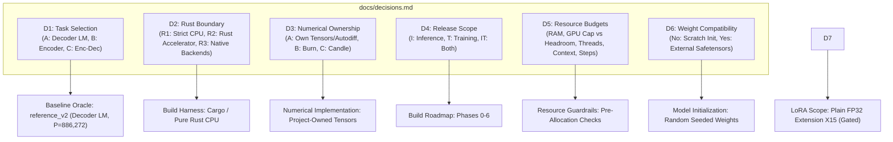
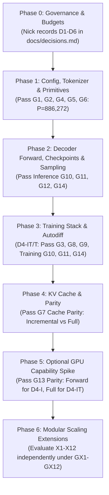

# Standalone Rust Transformer - Creation Specification V3 (`specv3.md`)

**Date:** 7 October 2026  
**Status:** Unified Authoritative Creation Specification & Architecture Blueprint  
**Controlling Authority:** Self-Contained Master Contract (Supersedes Spec V1, Spec V2, and all prior review addenda `reviewv1.md` through `reviewv10.md`).  
**Baseline Oracle:** `reference_v2` (Dense Decoder-Only Autoregressive Transformer, Multi-Head Attention $H_q = H_{kv} = 4$, $V=259$, $D=128$, $L=4$, FP32 CPU, $P=886,272$ tied parameters).  

---

## 0. Purpose, Reading Rules & Non-Negotiable Boundaries

### 0.1 Purpose
This document provides the complete, self-contained engineering specification to build a standalone transformer entirely in Rust from the ground up. It defines:
1. Architectural designs, mathematical formulations, and memory models.
2. Formal data storage contracts and reader specifications (`BufferedTokenShard` and `UnsafeMmapTokenShard`).
3. Core attention mechanics, mathematical FlashAttention-2 forward/backward formulations, and bounded metadata validators.
4. Falsifiable quality acceptance gates (`G1`–`G14` and `GX1`–`GX12`) with explicit numerical tolerances and structured evidence schemas.
5. A phased build sequence (Phases 0–6) with strict operational stop rules.
6. Open governance decisions (`D1`–`D6`) awaiting owner authorization (Nick).

This specification is completely self-contained. It incorporates and resolves all normative contracts and architectural findings across the adversarial review lineage (`rust-transformer-review-gaps` V1 through V10 and all Spec V3 gap reviews) and supersedes all intermediate review documents. No prior `.md` or `.txt` file is required to understand, build, or verify this project.

### 0.2 Reading Rules & Status Labels
* **CONFIRMED:** Core requirements explicitly set by project leadership:
  - A paste-ready, self-contained creation specification.
  - A standalone transformer implemented in Rust.
  - A completely independent repository (not a module, wrapper, or submodule of any existing personal assistant stack).
* **PROPOSED:** Concrete baseline designs supplied to enable rigorous review and immediate implementation upon approval.
* **GATED:** Capabilities that must not be built until the project owner explicitly records the corresponding architectural choice.
* **DEFERRED:** Features excluded from the initial release scope that remain optional research or scaling extensions.
* **HONEST BLUEPRINT LABELING:** All code blocks in this specification represent conceptual architectural blueprints, interface definitions, and pseudocode models. They serve as formal specification contracts for the implementation, not compiled, Miri-checked, or benchmarked runtime code.

### 0.3 Non-Negotiable Project Boundaries
1. **Repository Independence:** Do not import, wrap, copy, or link code from prior personal projects. The repository name remains the owner's choice (e.g., `SandyRust`).
2. **Standard Interfaces:** Only standard Rust toolchain interfaces (`cargo`, `rustc` edition 2021) and audited dependencies approved under Decision D2 are permitted.
3. **Strict R1 Platform Boundary (Proposed Decision D2 Policy):**
   - Pure Rust application and numerical implementation.
   - Disclosed exceptions: the Rust compiler, linker, standard OS interfaces (`std`), and platform runtime.
   - Proposed strict policy: Zero C, C++, or CUDA code in repository code or build dependencies (`build.rs`). This extends Spec V2's executed-application rule to build dependencies, awaiting Nick's formal recording in Decision D2.
   - Pinned `Cargo.lock`, offline CPU verification from a populated cargo cache, and zero hidden network downloads or background telemetry during test runs.
4. **No Phantom Claims:** No compilation, benchmark, hardware execution, or training convergence may be claimed until the respective falsifiable gate passes with reproducible artifacts.

---

## 1. Governance & Decisions to Record (`docs/decisions.md`)

Before implementation begins in Phase 1, the project owner (Nick) must record formal decisions for `D1`–`D6` in `docs/decisions.md`. The baseline specified throughout this document assumes the recommended choices ($D1=A, D2=R1, D3=A, D4=IT, D5=\text{tiny}, D6=\text{no}$), but the build order adapts if alternatives are selected.



### Decision Matrix

| Identifier | Decision Question | Candidate Options | Recommended Proposal | Impact if Alternative Chosen |
| :--- | :--- | :--- | :--- | :--- |
| **D1** | **Transformer Task** | **A.** Autoregressive Decoder-only LM<br/>**B.** Bidirectional Encoder<br/>**C.** Sequence-to-Sequence Enc-Dec<br/>**D.** Custom / Research Architecture | **A.** Autoregressive Decoder-only | Selecting B, C, or D requires revising attention masks, objectives, and test gates (per Spec V2 Section 0), not renaming the same model. |
| **D2** | **Rust Boundary** | **R1.** Strict CPU Rust (100% pure Rust dependencies, no C/CUDA/Python)<br/>**R2.** Rust-authored GPU kernels (e.g. CubeCL/WGPU)<br/>**R3.** Rust application over native numerical backends (e.g. LibTorch/CUDA C++) | **R1.** Strict CPU Rust (Proposed) | Proposed policy: extends Spec V2's executed-application restriction to strictly forbid C/C++ or CUDA code in build dependencies (`build.rs`) as well, awaiting Nick's formal recording in `docs/decisions.md`. Disclosed exceptions: Rust compiler, linker, standard OS interfaces (`std`), and runtime. |
| **D3** | **Numerical Ownership** | **A.** Project-owned tensors and custom reverse-mode autodiff<br/>**B.** Existing Rust framework for training (e.g. Burn)<br/>**C.** Existing Rust framework for inference (e.g. Candle) | **A.** Project-owned tensors & autodiff | Option A offers maximum educational and architectural control. Option B/C offloads tensor maintenance but requires auditing transitive dependencies under D2. |
| **D4** | **Release Scope** | **I.** Inference-only + model init + checkpoint loading<br/>**T.** Training-only from scratch + eval + checkpointing<br/>**IT.** Full Inference + Training stack | **IT.** Both (at tiny reference scale) | Selecting **I** defers Phase 3 (autodiff, optimizer, training dataloader); training gates (G3, G8, G9) are `NOT APPLICABLE`; KV cache may move to Phase 2. Selecting **T** defers generation/sampling UI (G12 `NOT APPLICABLE`). |
| **D5** | **Resource Budget** | Explicit limits on host RAM, GPU allocation cap, free system headroom, context length ($T$), batch size ($B$), thread count, max training steps, and dataset bytes. | **Tiny Profile:** 4 GiB Host RAM, $\le 1$ GiB GPU alloc cap, $\ge 4$ GiB system headroom, $T=64, B=2, \text{threads}=4, \le 500 \text{ steps}, \le 10 \text{ MB dataset}$. | Guardrails enforce pre-allocation checks before executing large matrix operations or dataset streaming. |
| **D6** | **Weight Compatibility** | **No:** Pure random initialization + tiny training from scratch.<br/>**Yes:** SafeTensors loading for external models (Llama, Gemma, Qwen). | **No.** Scratch training first. | Selecting **Yes** requires implementing architecture-specific alignment layers (RMSNorm epsilon variations, RoPE base frequencies, untied embeddings X2). |
| **D7** | **LoRA Adaptation Scope** | **D7-Off:** Deferred (Full fine-tuning only on base parameters).<br/>**D7-FP32:** Plain FP32 LoRA as optional extension X15 on frozen base after baseline gates pass.<br/>**D7-Full:** QLoRA / Quantized base weights / GRPO reinforcement learning. | **D7-FP32 (Proposed / Gated on base learning):** Approve plain FP32 LoRA as optional extension X15, only after base passes baseline gates and shows measured learning. QLoRA, quantized base weights, and GRPO remain strictly deferred. | Selecting D7-Full requires 4-bit/8-bit dequantization kernels and complex dependencies, violating D2-R1. Selecting D7-Off restricts adaptation experiments to full fine-tuning. |

---

## 2. Model Architecture: Dense Decoder-Only Transformer

### 2.1 Baseline Specification (`reference_v2`)
The baseline reference model is an autoregressive decoder-only transformer using standard Multi-Head Attention (MHA), Rotary Position Embeddings (RoPE), SwiGLU activation, and RMSNorm.

```
Input Token IDs [B, T]
       │
       ▼
Embedding Lookup E [V, D]  ─── (Tied with output projection)
       │
       ▼
   X [B, T, D]
       │
   ┌───┴───────────────────────────────────────────┐
   │ Loop over L = 4 Decoder Blocks:               │
   │                                               │
   │   1. Attention Sub-Block (MHA):               │
   │      R_attn = RMSNorm(X, W_rms1)              │
   │      Q = R_attn W_q,  K = R_attn W_k,         │
   │      V = R_attn W_v                           │
   │      Apply RoPE(Q), RoPE(K)                   │
   │      O_attn = Attention(Q, K, V)              │
   │      A_model = MergeHeads(O_attn) W_o         │
   │      X = X + A_model                          │
   │                                               │
   │   2. Feed-Forward Sub-Block (SwiGLU):         │
   │      R_ffn = RMSNorm(X, W_rms2)               │
   │      Gate = R_ffn W_gate                      │
   │      Up   = R_ffn W_up                        │
   │      Hidden = (Gate * sigmoid(Gate)) * Up     │
   │      F_model = Hidden W_down                  │
   │      X = X + F_model                          │
   └───┬───────────────────────────────────────────┘
       │
       ▼
Final RMSNorm(X, W_rms_final)
       │
       ▼
Logits = X · E^T  [B, T, V]  (Output Projection tied with Embedding E)
```

### 2.2 Hyperparameters & Structural Invariants
* **Vocabulary Size ($V$):** $259$ (256 raw byte values `0x00`–`0xFF` + 3 special tokens: `BOS=256`, `EOS=257`, `PAD=258`).
* **Model Hidden Dimension ($D$):** $128$.
* **Number of Layers ($L$):** $4$.
* **Query Attention Heads ($H_q$):** $4$.
* **Key/Value Attention Heads ($H_{kv}$):** $4$ (Standard Multi-Head Attention, $H_{kv} = H_q = 4$).
* **Head Dimension ($d_h$):** $D / H_q = 128 / 4 = 32$ (must be an even integer for adjacent-pair RoPE).
* **Feed-Forward Hidden Dimension ($d_{ff}$):** $384$ ($3 \times D$).
* **Validation Context Length ($T_{\max}$):** $64$ tokens on tiny fixture (deliberately chosen validation setting; $T \le 128$ supported).
* **Validation Batch Size ($B$):** $2$ on tiny fixture.
* **RoPE Base Frequency ($\theta$):** $10000.0$.
* **RMSNorm Epsilon ($\epsilon$):** $10^{-5}$.
* **Biases:** Strictly zero biases throughout the entire model ($W_{\text{bias}} = \text{None}$).
* **Dropout:** Strictly $0.0$ for deterministic baseline execution.
* **Numerical Precision:** 32-bit Single Precision Floating Point (IEEE 754 FP32).

### 2.3 Strict Parameter Inventory & Accounting

#### Baseline: Tied Embeddings ($P = 886,272$)
Under the baseline contract, the output classification projection shares weights with the token embedding matrix ($W_{\text{head}} \equiv E^T$).

1. **Token Embeddings ($E$):**
   $$V \times D = 259 \times 128 = 33,152 \text{ parameters}$$
2. **Per Decoder Block ($\times 4$ blocks):**
   * Pre-Attention RMSNorm ($W_{\text{rms1}}$): $D = 128$
   * Query Projection ($W_q$): $D \times (H_q \cdot d_h) = 128 \times 128 = 16,384$
   * Key Projection ($W_k$): $D \times (H_{kv} \cdot d_h) = 128 \times 128 = 16,384$
   * Value Projection ($W_v$): $D \times (H_{kv} \cdot d_h) = 128 \times 128 = 16,384$
   * Output Projection ($W_o$): $(H_q \cdot d_h) \times D = 128 \times 128 = 16,384$
   * Pre-FFN RMSNorm ($W_{\text{rms2}}$): $D = 128$
   * FFN Gate Projection ($W_{\text{gate}}$): $D \times d_{ff} = 128 \times 384 = 49,152$
   * FFN Up Projection ($W_{\text{up}}$): $D \times d_{ff} = 128 \times 384 = 49,152$
   * FFN Down Projection ($W_{\text{down}}$): $d_{ff} \times D = 384 \times 128 = 49,152$
   * *Subtotal per Layer:*
     $$128 + 16,384 + 16,384 + 16,384 + 16,384 + 128 + 49,152 + 49,152 + 49,152 = 213,248$$
   * *All 4 Layers ($4 \times 213,248$):* $852,992 \text{ parameters}$
3. **Final Layer:**
   * Final RMSNorm ($W_{\text{rms\_final}}$): $D = 128 \text{ parameters}$
   * Output Unembedding: $0$ additional parameters (reused from $E$).
4. **Total Baseline Parameters ($P$):**
   $$P = 33,152 + 852,992 + 128 = \mathbf{886,272 \text{ parameters}} \quad (\text{Gate } G6)$$

#### Modular Scaling Profiles: Head Counts & Untied Combinations

| Architecture Profile | Key Heads ($H_{kv}$) | KV Weight Size (per layer) | Layer Subtotal | Total Tied Parameters | Total Untied Parameters (X2) |
| :--- | :---: | :---: | :---: | :---: | :---: |
| **Baseline MHA (`reference_v2`)** | **4** | $16,384 + 16,384 = 32,768$ | $213,248$ | **$886,272$** (Gate `G6`) | **$919,424$** (Gate `GX2`) |
| **GQA Extension (X1, ratio 2)** | **2** | $8,192 + 8,192 = 16,384$ | $196,864$ | **$820,736$** (Gate `GX1`) | **$853,888$** |
| **MQA Extension (X1, ratio 4)** | **1** | $4,096 + 4,096 = 8,192$ | $188,672$ | **$787,968$** (Gate `GX1`) | **$821,120$** |

*Governing Rule:* The baseline oracle is strictly MHA tied ($886,272$). Untied embeddings is strictly modular extension X2 ($+33,152$). GQA and MQA are strictly modular extension X1.

---

## 3. Mathematical Formulations & Component Invariants

### 3.1 RMSNorm Forward & Analytic Gradients
Root Mean Square Normalization operates on vector $x \in \mathbb{R}^d$ with learned scale parameter $\gamma \in \mathbb{R}^d$ and constant $\epsilon = 10^{-5}$:
$$\text{RMS}(x) = \sqrt{\frac{1}{d} \sum_{i=1}^d x_i^2 + \epsilon}$$
$$\hat{x}_i = \frac{x_i}{\text{RMS}(x)}, \quad y_i = \hat{x}_i \cdot \gamma_i$$

* **Scale Initialization:** $\gamma_i = 1.0$ for all $i \in \{1, \dots, d\}$.
* **Zero Bias:** Strictly no learned bias parameter ($b = \text{None}$).
* **Invariant Note (Gate G5):** Learned $\gamma$ and the absence of mean subtraction do *not* enforce unit variance output. Gate G5 verifies numerical adherence to the algebraic RMSNorm equation and its exact analytic gradient:
  $$\frac{\partial \mathcal{L}}{\partial x_i} = \frac{\gamma_i}{\text{RMS}(x)} \frac{\partial \mathcal{L}}{\partial y_i} - \frac{x_i}{d \cdot \text{RMS}(x)^3} \sum_{j=1}^d \left( x_j \gamma_j \frac{\partial \mathcal{L}}{\partial y_j} \right)$$
  $$\frac{\partial \mathcal{L}}{\partial \gamma_i} = \frac{\partial \mathcal{L}}{\partial y_i} \cdot \hat{x}_i$$

### 3.2 Adjacent-Pair Rotary Position Embeddings (RoPE)
RoPE transforms query and key head vectors at absolute token sequence position $m \in \{0, \dots, T-1\}$. For head dimension $d_h = 32$, vectors are partitioned into $d_h / 2 = 16$ adjacent coordinate pairs $(x_{2k}, x_{2k+1})$ for $k \in \{0, \dots, 15\}$:
$$\theta_k = \theta^{-2k / d_h} = 10000.0^{-2k / 32}$$
$$\begin{pmatrix} x'_{2k} \\ x'_{2k+1} \end{pmatrix} = \begin{pmatrix} \cos(m \theta_k) & -\sin(m \theta_k) \\ \sin(m \theta_k) & \cos(m \theta_k) \end{pmatrix} \begin{pmatrix} x_{2k} \\ x_{2k+1} \end{pmatrix}$$

* **Rotary Properties:**
  1. **Norm Preservation:** $\|x'\|_2 = \|x\|_2$ (orthogonal rotation).
  2. **Relative Shift Invariant:** $\langle \text{RoPE}(q, m), \text{RoPE}(k, n) \rangle = g(q, k, m - n)$.
  3. **Even Dimension Precondition:** $d_h$ must be an even integer ($d_h \% 2 == 0$).

### 3.3 Stable Softmax & Attention Masking Rules
For attention score row $z \in \mathbb{R}^{T_k}$:
$$\text{softmax}(z)_i = \frac{\exp(z_i - \max_{j} z_j)}{\sum_{k=1}^{T_k} \exp(z_k - \max_{j} z_j)}$$
* **Causal Mask:** $M_{i,j}^{\text{causal}} = 0.0$ for $j \le i$, and $-\infty$ for $j > i$.
* **Padding Mask:** $M_{i,j}^{\text{pad}} = -\infty$ if token $j$ is padding (`PAD=258`).
* **Mask Invariants (Gate G4):**
  1. *Polarity:* In boolean masks, `true` indicates valid tokens; `false` indicates masked tokens.
  2. *Zero Probability Leakage:* Softmax probability for future or padding tokens is strictly $0.0$.
  3. *Zero Padded Query Output:* Queries belonging to padding tokens output zero vectors ($0.0$).
  4. *Fully Masked Query Error:* If a valid query row has all keys masked out, the engine returns an error.

### 3.4 SwiGLU Activation & Feed-Forward Network
$$\text{silu}(z) = z \cdot \text{sigmoid}(z) = \frac{z}{1 + \exp(-z)}$$
$$\text{SwiGLU}(x) = \left( \text{silu}(x W_{\text{gate}}) \right) \odot (x W_{\text{up}})$$
$$\text{FFN}(x) = \text{SwiGLU}(x) W_{\text{down}}$$
Where $x \in \mathbb{R}^{B \times T \times D}$, $W_{\text{gate}}, W_{\text{up}} \in \mathbb{R}^{D \times d_{ff}}$, and $W_{\text{down}} \in \mathbb{R}^{d_{ff} \times D}$.

### 3.5 Seeded Weight Initialization
* Linear weights $W_q, W_k, W_v, W_{\text{gate}}, W_{\text{up}}$ are sampled from $\mathcal{N}(0, \sigma^2)$ with $\sigma = 0.02$.
* Residual output projections $W_o$ and $W_{\text{down}}$ are initially sampled from unscaled $\mathcal{N}(0, 0.02^2)$ and scaled by $1 / \sqrt{2L} = 1 / \sqrt{8} \approx 0.35355$ as an architectural initialization heuristic to control activation variance growth across residual layers.
* RMSNorm scale parameters $\gamma$ are initialized to $1.0$.
* Token embeddings $E$ are sampled from $\mathcal{N}(0, 0.02^2)$.
* Biases are strictly zero. The exact PRNG seed and method (ChaCha20 or Philox with Box-Muller transform) are recorded in configuration.

### 3.6 Configuration, Tensor Storage & Autodiff Preconditions
* **Configuration Validation:**
  - **Finiteness & Numeric Bounds:** Enforces that all floating-point hyperparameters are finite: `epsilon.is_finite() && epsilon > 0.0` (finite strictly positive, e.g. $10^{-5}$), and `theta.is_finite() && theta > 1.0` (finite base frequency, e.g. $10000.0$).
  - **Integer Invariants:** Enforces positive non-zero dimensions $D > 0, H_q > 0, H_{kv} > 0, L > 0, d_{ff} > 0$.
  - **Divisibility Rules:** $D \% H_q == 0$, $H_q \% H_{kv} == 0$, and head dimension $d_h = D / H_q$ must be an even positive integer ($d_h \% 2 == 0$).
  - **Vocabulary & Sequence Capacities:** Validates token vocabulary size $V \ge 259$ and maximum context length $T_{\max} \ge 1$.
  - **Configurable Special Tokens:** Enforces pairwise distinct special token IDs bounded within the vocabulary: for byte tokenizer, baseline IDs are fixed at $\text{BOS}=256, \text{EOS}=257, \text{PAD}=258$ with $256 \le \text{BOS}, \text{EOS}, \text{PAD} < V$, and pairwise distinct ($\text{BOS} \ne \text{EOS}$, $\text{BOS} \ne \text{PAD}$, $\text{EOS} \ne \text{PAD}$). Any custom configuration must satisfy $256 \le \text{BOS}, \text{EOS}, \text{PAD} < V$ to avoid colliding with raw byte tokens $0..255$.
  - **Pre-Allocation Resource Bounds:** Enforces maximum allocation caps ($T_{\max} \le 8192$, batch size $B \le 256$, and maximum tensor allocation byte limits) *before* attempting memory construction.
  - **Schema Versioning & Unknown Field Rejection:** Requires explicit `schema_version = 1`. Any unknown or unapproved extension fields (e.g. unselected `X1`–`X12` attributes) are rejected with a typed validation error.
  - **Sequence Packing Deferral:** Sequence packing is explicitly deferred to modular extensions; baseline implementation enforces single-document right-padded sequences where queries and keys strictly share identical document boundaries.
* **Tensor Representation & Operation Contracts:**
  - **Storage Layout & Precision:** Row-major contiguous buffer (`Vec<f32>`), explicit shape `[usize]`, stride `[usize]`, default runtime dtype `FP32`, and device `CPU`.
  - **Scoped FP64 Diagnostic Precision Path:** While production runtime inference and training execute in `FP32` (`Vec<f32>`), the tensor representation and kernel engine provide a scoped `FP64` (`f64`) diagnostic path specifically for Gate G3 finite-difference gradient verification when training is selected (`D4-IT` / `D4-T`): model parameters and forward activations are cast to `f64` (or evaluated via an `f64`-generic mirror model path) to compute double-precision forward loss and two-sided finite-difference central gradients with perturbation $\epsilon=10^{-5}$ without single-precision floating-point cancellation, leaving production weights and runtime memory buffers strictly `Vec<f32>`.
  - **Checked Allocation & Indexing:** All element offsets, strides, and memory sizes are calculated using checked arithmetic (`checked_mul`, `checked_add`), returning typed `AllocationOverflowError` on failure.
  - **Operation Interfaces & Error Contracts:** Supports verified forward primitives (`matmul`, `add`, `silu`, `mul`, `rms_norm`, `rope`, `logsumexp`) and tensor operations (`reshape`, `transpose`, `batched_matmul`, `gather`, `reduction`). Mismatched ranks or non-broadcastable shapes return typed `ShapeMismatchError`, invalid ranks return `RankError`, out-of-bounds indices return `IndexOutOfBoundsError`, and non-contiguous strided views must be cloned to contiguous storage before invoking standard dense kernels.
  - **Broadcast & Layout Restoration:** Dimensions must match exactly or singleton dimensions ($1$) expand along leading or trailing axes (no silent flattening). Transpose and broadcast operations strictly restore contiguous memory layouts after backward pass reductions.
* **Custom Autodiff Preconditions (D3-A Training Scope):**
  - **Tape Lifecycle:** Directed Acyclic Graph (DAG) with explicit tape lifetime; nodes are consumed and reset at step boundaries without ownership cycles.
  - **Evaluation Isolation:** Evaluation mode (`no_grad`) completely suppresses tape construction and graph allocation.
  - **Tied & Shared Gradient Accumulation:** For tied embeddings ($E \equiv W_{\text{head}}^T$), gradients from both input lookup ($dE_{\text{lookup}}$) and output projection ($dW_{\text{head}} = dZ^T \cdot X$) accumulate into a single shared parameter gradient buffer: $dE = \text{scatter\_add}(dE_{\text{lookup}}) + dW_{\text{head}}^T$. Enforces a strict no-duplicate-backward execution rule for shared/aliased tensors.
  - **Sequence Position & Segment Mapping:** Under generalized offset attention modes, sequence positions map via absolute positions $p_q = q + \text{offset}$ and $p_k = k$ for segment comparisons (`segment_ids[p_q] == segment_ids[p_k]`). In baseline single-document mode, $p_q = q, p_k = k$.
  - **Activation Immutability:** Graph-saved forward activations are strictly immutable during backward pass execution; parameter updates occur only after gradient validation succeeds.

---

## 4. Modular Scaling & Interpretability Extensions (`X1`–`X16`, `X12-E`)

Scaling and interpretability extensions (`X1`–`X16` and `X12-E`) are defined normatively below. **All extensions remain disabled by default** in the baseline implementation. They may only be evaluated individually in Phase 6 after all applicable baseline gates have passed.

```mermaid
graph LR
    subgraph Baseline Core [reference_v2]
        MHA["MHA (H_kv=4, P=886,272)"]
        Tied["Tied Embeddings"]
        PureCPU["Pure CPU FP32"]
        ContigKV["Contiguous KV Cache"]
    end

    subgraph Modular Scaling Extensions [Phase 6 Scaling Catalog]
        X1["X1: GQA / MQA"]
        X2["X2: Untied Embeddings"]
        X3["X3: QK-Norm"]
        X4["X4: RoPE Context / Layouts"]
        X5["X5: Optimized CPU GEMM"]
        X6["X6: Typed Buffer Reuse"]
        X7["X7: Chunked Loss & Recompute"]
        X8["X8: FlashAttention-2 / Custom Kernels"]
        X9["X9: BPE Tokenizer & Mmap Loading"]
        X10["X10: Mixed Precision FP16/BF16"]
        X11["X11: Paged KV Cache"]
        X12["X12: Min-P Sampling"]
    end

    subgraph Interpretability & Adaptation [Addendum A1 Extensions]
        X12E["X12-E: Entropy-Feedback Sampling"]
        X13["X13: Activation Hooks & Steering"]
        X14["X14: Flip-Rate Semantic Eval"]
        X15["X15: FP32 LoRA (Gated on D7)"]
        X16["X16: Associative Fast-Weight Memory"]
    end

    Baseline Core -.->|Phase 6 Individual Evaluation| Modular Scaling Extensions
    Baseline Core -.->|Optional Inspection / Adaptation| Interpretability & Adaptation
```

### 4.1 Foundational Principles & Extension Protocol

1. **Baseline Unchanged:** With every extension disabled (the default), build, parameter counts, checkpoints, cache identity, and baseline quality gates (`G1`–`G14`) behave exactly as defined in the baseline specification. Parameter counts stay strictly $886,272$ tied ($919,424$ untied) for MHA, $820,736$ tied for GQA, and $787,968$ tied for MQA.
2. **Phase 6 Evaluation Isolation:** All extensions are disabled by default and evaluated only in Phase 6 (Section 10), one at a time, after every applicable baseline gate passes. Each extension must maintain an architectural record, explicit memory lifecycle, checkpoint migration rules, and undergo a mandatory baseline rerun.
3. **Strict Config Gating:** Unknown extension fields are rejected at config validation time. Each extension registers exactly one primary config key (`ext_x1_gqa` through `ext_x16_memory`). A key that is false or absent means disabled and must execute byte-identically to a build without the extension.
4. **Dependency Compliance:** No external crates are added. Proposed Decision D2 (100% pure Rust std, zero C/C++/CUDA in build scripts) applies unchanged.
5. **Out of Scope Boundary:** Explicitly out of scope for all extensions: graph, sheaf, hyperbolic, or Fisher retrieval; Dianoia or Krisis style layers; RLM or OODA autonomous agents; GRPO or any reinforcement learning loop for EXPAND/BACKTRACK/ANSWER; external vector stores; network access; Python or external interop. Under 0.9M parameters, these extensions provide an inspectable test bench for architectural ideas, not claims of emergent general reasoning.
6. **Recommended Implementation Sequence & Dependencies:**
   - **X13 (Activation Hooks & Steering):** Needs only baseline forward pass and KV cache. Plan named hook sites into Phase 2 forward design early to avoid retrofitting every layer function.
   - **X14 (Flip-Rate Evaluation):** Independent semantic harness; uses X13 only for an optional steered evaluation arm.
   - **X12-E (Entropy-Feedback Sampling):** Independent generation controller; Min-P mode requires X12 and Gate `GX12` passed.
   - **X15 (FP32 LoRA):** GATED on Decision D7. Requires a trained baseline checkpoint that has demonstrated measurable learning.
   - **X16 (Associative Memory):** Isolated branch, lowest priority. Requires all baseline gates and Gate `GX7` passed.

---

### 4.2 Detailed Extension Contracts (`X1`–`X12`)

1. **X1: Grouped-Query Attention (GQA) & Multi-Query Attention (MQA):**
   * **Mathematical Formulation & Oracle:** Configures $H_{kv} \in \{1, 2\}$ on baseline $H_q = 4$. Group size $G = H_q / H_{kv}$. Query heads $h \in [g \cdot G, (g+1) \cdot G - 1]$ map to key/value head $g$. Forward oracle is mathematically identical to repeating KV heads $G$ times along the head dimension before standard MHA dot-product attention: $y = \text{softmax}(QK^T / \sqrt{d_h})V$.
   * **Memory & Storage:** Physical KV cache is stored as $[B, H_{kv}, \text{capacity}, d_h]$ without duplicate expanded copies in memory.
   * **Gradient Accumulation:** Shared KV gradient accumulation aggregates query head gradients into KV projections: $dK_g = \sum_{h \in \text{group}(g)} dK_h$ and $dV_g = \sum_{h \in \text{group}(g)} dV_h$.
   * **Parameter Counts:** $820,736$ tied ($853,888$ untied) for $H_{kv}=2$; $787,968$ tied ($821,120$ untied) for $H_{kv}=1$.
   * **Checkpoint Migration & Verification:** Checkpoints record explicit $H_{kv}$ metadata; loading across differing $H_{kv}$ profiles without an explicit weight-migration tool is rejected by header validation. Verified by Gate `GX1` (head ratio parity across $H_q / H_{kv} \in \{1, 2, 4\}$, cache allocation, one AdamW update, and checkpoint reload).

2. **X2: Untied Embeddings:**
   * **Separation & Storage:** Decouples token embedding $E \in \mathbb{R}^{V \times D}$ from output unembedding projection $W_{\text{head}} \in \mathbb{R}^{D \times V}$. Establishes distinct physical memory buffers (not equal copies or aliased views), distinct stable tensor IDs (`id_E != id_Whead`), separate gradients ($dE$ via lookup scatter-add, $dW_{\text{head}} = X^T \cdot dz$), and dedicated independent AdamW optimizer moments ($m_E, v_E$ and $m_{W}, v_{W}$).
   * **Parameter Inventory:** Parameter count equals exactly $919,424$ on MHA ($853,888$ on GQA, $821,120$ on MQA).
   * **Perturbation & Update Verification:** Verified by Gate `GX2` (verifying parameter perturbation of $E$ does not affect $W_{\text{head}}$, separate gradient accumulation, parameter count assertion, and checkpoint reload).

3. **X3: QK-Norm:**
   * **Formulation & Axis:** Applies RMSNorm over the last $d_h$ axis to $Q$ and $K$ heads *before* dot-product attention and RoPE: $\tilde{Q}_{b,t,h} = \text{RMSNorm}(Q_{b,t,h}, \gamma_q^h)$, $\tilde{K}_{b,t,g} = \text{RMSNorm}(K_{b,t,g}, \gamma_k^g)$.
   * **Parameters & Scaling:** Learned per-head scale parameters $\gamma_q \in \mathbb{R}^{H_q \times d_h}$ and $\gamma_k \in \mathbb{R}^{H_{kv} \times d_h}$ initialized to $1.0$, with finite $\epsilon = 10^{-5}$, zero bias, and preserving standard $1/\sqrt{d_h}$ attention scaling. Scale vectors are serialized with explicit layer/head/axis order.
   * **Parameter Inventory:** Adds $L \cdot (H_q + H_{kv}) \cdot d_h$ parameters ($+1,024$ on MHA, $+768$ on GQA, $+640$ on MQA).
   * **Verification:** Verified by Gate `GX3` (zero-input stability, analytic gradients matching finite differences, attention score entropy stability, and checkpoint reload).

4. **X4: Advanced RoPE Extensions & Layouts:**
   * **Scaling Formulations & Exact YaRN Equations:** Linear frequency interpolation ($\theta'_i = \theta_i \cdot (T_{\text{train}} / T_{\text{target}})$) and YaRN context scaling for extended context lengths $T_{\text{target}} > T_{\text{train}} = 64$. With base frequencies $\theta_i = b^{-2i / d_h}$ ($b=10000.0$), wavelength $\lambda_i = 2\pi / \theta_i$, and scale ratio $s = T_{\text{target}} / T_{\text{train}} > 1.0$:
     - Low-frequency band ($\lambda_i > \beta \cdot T_{\text{train}}$): linear scale $\theta'_i = \theta_i / s$.
     - High-frequency band ($\lambda_i < \alpha \cdot T_{\text{train}}$): unscaled $\theta'_i = \theta_i$.
     - Intermediate band ($\alpha \cdot T_{\text{train}} \le \lambda_i \le \beta \cdot T_{\text{train}}$): smooth ramp interpolation $\gamma_i = (\lambda_i / T_{\text{train}} - \alpha) / (\beta - \alpha)$ with $\theta'_i = (1 - \gamma_i) \theta_i + \gamma_i (\theta_i / s)$, where standard hyperparameters are fixed at $\alpha = 1.0, \beta = 32.0$.
     - Attention logit temperature correction scales attention logits by factor $\sqrt{1 / t}$ where $t = 0.1 \ln(s) + 1.0$.
   * **Coordinate Layouts:** Supports verified coordinate conversion between adjacent-pair $[(x_{2k}, x_{2k+1})]$ and split $[x_0..x_{d/2-1}, x_{d/2}..x_{d-1}]$ head layouts with permutation inverse checks.
   * **Compatibility & Fixtures:** Enforces exact model/revision/hash/license/tokenizer compatibility, known-logit fixtures at context boundary $T=256$, and strict vector norm preservation. Verified by Gate `GX4`.

5. **X5: Optimized CPU GEMM Kernels:**
   * **Layout & Dispatch:** Strictly row-major contiguous storage (`[M, K]`, `[K, N]`). Loop tiling, cache blocking, and architecture-specific SIMD dispatch (AVX2/AVX-512/NEON) with portable pure-Rust fallback.
   * **Transpose & Stride Policy:** Transposed matrix inputs either materialize a contiguous temporary buffer via checked copy or evaluate inner products using explicit stride vectors $(s_{\text{row}}, s_{\text{col}})$.
   * **Tail Dimension & Alignment Policy:** Odd or non-SIMD-aligned dimensions ($M, N, K$ not multiples of register width) are processed without out-of-bounds reads using explicit scalar loop peeling for remainder elements.
   * **Threading Policy:** Multi-threading partitions work strictly over the outer $M$ dimension with dynamic chunk size $\max(1, M / N_{\text{threads}})$, using thread-local accumulation buffers to guarantee deterministic sum reductions.
   * **Numerical Parity Metric:** Requires componentwise numerical parity ($|x_i - \hat{x}_i| \le \text{atol} + \text{rtol} \cdot |\hat{x}_i|$ with $\text{atol} = 10^{-5}, \text{rtol} = 10^{-4}$) across odd, strided, and batched inputs, and benchmarked wall-clock speedup against reference GEMM. Verified by Gate `GX5`.

6. **X6: Typed Buffer Reuse & In-Place Allocator:**
   * **Arena Management & Alignment:** Pre-allocated scratch arena enforcing strict 64-byte alignment (`offset.checked_add(align_pad)` where `align_pad = (64 - (offset % 64)) % 64`), checked `isize` offsets, and typed buffer handles. Enforces zero heap allocations during steady-state forward and backward iterations.
   * **Capacity Caps & OOM Resilience:** Total arena capacity bounded by `max_arena_bytes` (e.g. 512 MiB). Exceeding capacity returns typed `Err(ArenaAllocationError::OutOfMemory)` without panicking or memory corruption. Explicit tests verify OOM error return under tight capacity limits.
   * **Lifetime & Thread Isolation:** Scratch handles are reset after consumer execution, are never referenced by an active autograd tape, enforce thread-local worker isolation, and preserve retained disjoint views. Gracefully handles cancelled steps and multi-step gradient accumulation without memory creep. Verified by Gate `GX6`.

7. **X7: Memory-Efficient Chunked Cross-Entropy & Activation Recomputation:**
   * **Chunked Formulation:** Computes classification loss in sequential sequence chunks ($T_{\text{chunk}} = 16$), avoiding materializing the full $B \times T \times V$ logit tensor.
   * **Activation Recomputation:** Recomputes intermediate activation $X$ during backward pass ($d_{\text{hidden}} = dz \cdot W_{\text{head}}^T, dW_{\text{head}} += \text{hidden}^T \cdot dz$) without retaining chunk logits.
   * **Immutability Invariant:** Parameters, attention masks, position IDs, and PRNG states remain strictly immutable during recomputation.
   * **Normalization & Tape Integration:** Tail chunks, padding masks, and zero-valid tokens handled with global valid-token denominator normalization ($\sum N_{\text{valid}}$). Custom VJP integrates into tape without duplicate backward execution. Verified by Gate `GX7`.

8. **X8: FlashAttention-2 / Custom Tiled Attention:**
   * **Block Tiling:** Block-tiled attention with online row-wise softmax recurrence ($B_r = 16, B_c = 16$), causal offset support ($k \le q + \text{offset}$), and backward pass recomputing $P$ from saved $LSE$ without storing quadratic $S$ and $P$ matrices.
   * **Padded Query Invariant:** Forward and backward loops unconditionally skip and zero padded query rows ($O_q = \mathbf{0}, dQ_q = \mathbf{0}, dS = 0.0, \delta_q = 0.0$).
   * **Offset Validation & Absolute Segment Indexing:** In chunked prefill / prefix caching, $\text{causal\_offset}$ satisfies $q\_len + \text{causal\_offset} \le k\_len$. The segment array length must cover the full key span $k\_len$ (or $B \cdot k\_len$). Absolute positions $p_q = q + \text{causal\_offset}$ (or $b \cdot k\_len + q + \text{causal\_offset}$) and $p_k = k$ (or $b \cdot k\_len + k$) are checked in-bounds before segment matching (`segment_ids[p_q] != segment_ids[p_k]`).
   * **Tail Bounds & Scratch Memory:** Row bounds clamped to $\min(i_{\text{start}} + B_r - 1, T_q - 1)$ and column bounds to $\min(j_{\text{start}} + B_c - 1, T_k - 1)$. Bounded scratch memory ($O(B_r \cdot d_h + B_c \cdot d_h)$) with zero quadratic $T \times T$ tape memory. Verified by Gate `GX8`.

9. **X9: Byte-Pair Encoding (BPE) Tokenizer & Optional Mmap Dataset Loading:**
   * **BPE Tokenizer Policy:** Train-only subword BPE tokenizer with deterministic byte-level pre-tokenization, merge rules table, vocabulary size $V_{\text{BPE}} > 259$, and SHA-256 vocabulary fingerprinting. Text normalization applies deterministic UTF-8 NFC normalization. Merge rules table and vocabulary mappings are immutable and frozen at initialization.
   * **Special Token Isolation:** Special tokens (`BOS=256`, `EOS=257`, `PAD=258`) are strictly reserved and forbidden from participating in BPE pair merges; raw byte tokens $0..255$ and specials remain isolated.
   * **Memory-Mapped Loading:** Memory-mapped token shard streaming (`UnsafeMmapTokenShard`) enforcing immutable file preconditions, pre-mapping `max_bytes` size caps, and atomic stream cursor rewind. Verified by Gate `GX9`.

10. **X10: Mixed Precision Training (FP16/BF16) & Loss Scaling:**
    * **Master Weights & Reductions:** Stores FP32 master weights and optimizer moments while executing GEMMs in FP16/BF16. Reductions, softmax, and loss computed in FP32. Gradients unscaled before clipping.
    * **Loss Scaling:** Supports configurable constant or dynamic loss scaling.
    * **Skipped-Step Data Policy:** On non-finite gradients (NaN/Inf), update is skipped, optimizer moments and step counter are unchanged, data loader cursor advances (tokens consumed), dynamic scale factor is halved, with a hard bound of `max_consecutive_skips = 5` before halting with `TrainingError::ExcessiveConsecutiveSkips(5)`. Verified by Gate `GX10`.

11. **X11: Paged KV Cache Management:**
    * **Block Paging & Tables:** Fixed-size block pages (e.g. 16 tokens). Logical-to-physical block table mapping.
    * **Transaction Safety:** Reserve-before-append transaction with atomic rollback on allocation failure. Multi-session isolation with generational pool counters.
    * **Lifecycle & Reclaim:** Reclaims unreferenced memory pages from finished sessions without rebasing or evicting live positions. Double-free and stale-handle assertions. Verified by Gate `GX11`.

12. **X12: Min-P Sampling & Advanced Generation:**
    * **Dynamic Truncation:** Filters tokens below $p < p_{\max} \cdot \text{min\_p}$ with finite $\text{min\_p} \in [0.0, 1.0]$ ($\text{min\_p} = 0.0$ disables Min-P).
    * **Pipeline Order & Determinism:** Executed strictly after stable softmax and before Top-K filtering in the sampling pipeline. Equal probability ties broken deterministically by smallest token ID. Verified by Gate `GX12`.

---

### 4.3 Addendum Extensions (`X12-E`, `X13`–`X16`)

13. **X12-E: Entropy-Feedback Adaptive Sampling (key: `ext_x12e_entropy_sampling`):**
    * **Formulation & Controller:** Extends X12. At each stochastic generation step ($T > 0$), after stable softmax, compute entropy $H = -\sum_{i=1}^V p_i \ln p_i$ over the full distribution ($p_i = 0$ terms contribute 0). Track exponential moving average:
      $$H_{\text{ema}} \leftarrow \beta \cdot H_{\text{ema}} + (1 - \beta) \cdot H$$
      initialized to the first observed $H$. Operates in exactly one validated control mode per run:
      - **Temperature Control Mode:**
        $$T_{\text{eff}} = \text{clamp}\left(T_{\text{base}} \cdot \left(1 + k \cdot \frac{H_{\text{target}} - H_{\text{ema}}}{H_{\max}}\right), T_{\min}, T_{\max}\right)$$
        where $H_{\max} = \ln(V_{\text{allowed}})$.
      - **Min-P Control Mode (requires X12):**
        $$\text{min\_p}_{\text{eff}} = \text{clamp}\left(\text{min\_p}_{\text{base}} \cdot \left(1 + k \cdot \frac{H_{\text{ema}} - H_{\text{target}}}{H_{\max}}\right), 0.0, \text{min\_p}_{\text{cap}}\right)$$
    * **Config Invariants:** Validated at config time: $\beta \in [0, 1)$, finite $k$, $H_{\text{target}} \in [0, H_{\max}]$, $T_{\min} > 0$, $T_{\max} \ge T_{\min}$, $\text{min\_p}_{\text{cap}} \in [0, 1)$. Order is fixed: step $n$ uses $H_{\text{ema}}$ through step $n-1$; then $H_n$ updates $H_{\text{ema}}$.
    * **Determinism & State Isolation:** Controller state $\{H_{\text{ema}}, \text{steps}\}$ is session state reset per generation. Because it does not modify K/V states, it is excluded from the K/V cache hash. Greedy decoding (temperature $0.0$) bypasses the controller and consumes zero PRNG state. Setting $k=0.0$ reproduces fixed-parameter sampling bitwise.
    * **Error Conditions:** Invalid config returns `GenerationError::InvalidAdaptiveConfig(&'static str)`; non-finite $H$ stops generation immediately with `GenerationError::ControllerNonFinite { step }`. Verified by Gate `GX12E`.

14. **X13: Activation Hooks & Bounded Steering (key: `ext_x13_hooks`):**
    * **Purpose & Scope:** Provides inspectability and bounded interventions: activation recording, head ablation, activation patching, and bounded inference-time steering vectors. Training-time steering and default-path modifications are strictly out of scope.
    * **Named Hook Sites:** Identified by `HookId { layer: u16, site: HookSite, head: Option<u16> }` over standard $[B, T, \dots]$ FP32 layouts:
      1. `EmbedOut` $[B, T, D]$
      2. `ResidPre` $[B, T, D]$
      3. `AttnNormOut` $[B, T, D]$
      4. `Q`, `K`, `V` per head $[B, T, d_h]$ ($K$ after RoPE as stored in cache; `KPreRope` separately; under X3 QK-Norm: `QPreNorm` / `KPreNorm`)
      5. `AttnScores` pre-softmax per head $[B, T_q, T_k]$ (export only)
      6. `AttnPattern` post-softmax per head $[B, T_q, T_k]$ (export only)
      7. `HeadOut` per head before $W_o$ $[B, T, d_h]$
      8. `AttnOut` after $W_o$ $[B, T, D]$
      9. `ResidMid` $[B, T, D]$
      10. `MlpNormOut` $[B, T, D]$, `MlpHidden` $[B, T, d_{ff}]$ (post-SwiGLU), `MlpOut` $[B, T, D]$
      11. `ResidPost` $[B, T, D]$
      12. `FinalNormOut` $[B, T, D]$, `Logits` $[B, T, V]$
    * **Operating Modes:**
      - **`Off` (default):** Single config boolean branch; zero heap allocations on hot path; bitwise baseline parity.
      - **`Record`:** Read-only export into caller-provided bounded sink. Explicitly specifies `PreEdit` or `PostEdit`.
      - **`Edit` (opt-in `ext_x13_edit = true`):**
        * `Ablate { hook, kind: Zero | MeanFromSink }` on head output or MLP slice.
        * `Patch { hook, source: ActivationSet }` replaces site values; shapes must match exactly.
        * `Steer { hook, direction_id, alpha }`: $h' = h + \alpha \cdot v$ at residual sites (`ResidPre`, `ResidMid`, `ResidPost`). Positions: `AllPositions`, `LastPosition`, or `PositionRange { start, end }`. Edit applies first; Record captures post-edit unless PreEdit is specified.
    * **Safety Bounds:** Hard sink cap `max_export_bytes` (default 64 MiB, ceiling 1 GiB) checked with `checked_mul`. Exceeding returns `HookError::ExportTooLarge`. $|\alpha| \le \alpha_{\max}$ (default 8.0); steering vector $v \in \mathbb{R}^D$ must have finite non-zero L2 norm.
    * **Direction Header Schema:** Binary direction files enforce 64-byte header: `{ schema_version, direction_id, dim: D, layer, site, model_instance_id, checkpoint_hash, tokenizer_fingerprint, extraction_method, created_from_dataset_hash, norm, notes }` followed by $D$ FP32 values and SHA-256 payload hash. Mismatched checkpoint or tokenizer is rejected with `HookError::DirectionMismatch`.
    * **Cache Binding Invariant:** Cache binding tuple gains `intervention_policy_hash` (SHA-256 digest of active edits, directions, alphas, and position selections; fixed constant when empty). Switching steering parameters with a reused cache is rejected with `GenerationError::CacheInterventionMismatch`. Checkpoints never store interventions.
    * **Typed Error Enum:**
      ```rust
      #[derive(Debug, Clone, PartialEq)]
      pub enum HookError {
          UnknownSite { layer: u16, site: String },
          ShapeMismatch { expected: Vec<usize>, actual: Vec<usize> },
          ExportTooLarge { requested: u128, max: u64 },
          InvalidSteering { reason: String },
          DirectionMismatch { field: String },
          PositionOutOfRange { start: usize, end: usize, t: usize },
          ModeNotEnabled,
      }
      ```
    * Verified by Gate `GX13`.

15. **X14: Paired Perturbation / Flip-Rate Evaluation (key: `ext_x14_eval`):**
    * **Purpose & Test Bench:** Provides a semantic behavioral test bench evaluating whether decisive prompt edits change model predictions while paraphrases or irrelevant distractors preserve them. Starts with deterministic synthetic generators (key-value lookup with overwrite; copy with marker change; digit string comparisons; marked symbol counting).
    * **Data Structure:** Organized into `Family` units sharing a base prompt. A `Pair` consists of `(base, variant, expected_relation)` with relation in $\{\text{MustFlip}, \text{MustNotFlip}\}$. Evaluated against a closed answer set per task with exact argmax matching. Labels originate from an independent deterministic rule-based oracle.
    * **Metrics & Baselines:** Evaluated on test split:
      1. $\text{flip\_rate}_{\text{must\_flip}}$
      2. $\text{flip\_rate}_{\text{must\_not\_flip}}$ (lower is better)
      3. Base and variant oracle correctness
      4. $\text{selectivity} = \text{flip\_rate}_{\text{must\_flip}} - \text{flip\_rate}_{\text{must\_not\_flip}}$
      Reported alongside trivial baselines: `always_flip`, `always_same`, `copy_base_answer`, and `uniform_random`. Models failing to beat the best trivial baseline receive verdict `NO_SIGNAL`.
    * **Uncertainty & Protocol Integrity:** Uncertainty estimated via family-clustered bootstrap (resampling families, fixed seed, 2000 resamples, 95% percentile interval). Runs with fewer than `min_test_families = 30` are marked `UNDERPOWERED`. Protocol rules, seeds, and thresholds are frozen and hashed in `eval/x14_protocol.json` prior to test evaluation. No base prompt may appear in multiple splits (`EvalError::SplitLeak`). Verified by Gate `GX14`.

16. **X15: FP32 Low-Rank Adaptation (LoRA) (key: `ext_x15_lora`, GATED on Decision D7):**
    * **Scope & Governance:** Gated on project leadership recording Decision D7 in `docs/decisions.md`. Strictly limited to plain FP32 LoRA on frozen base weights after the base model demonstrates measured learning. QLoRA, 4-bit/8-bit quantization, and GRPO are strictly deferred.
    * **Formulation:** For frozen weight $W \in \mathbb{R}^{d_{\text{out}} \times d_{\text{in}}}$:
      $$W' = W + \frac{\alpha}{r} B A$$
      where $A \in \mathbb{R}^{r \times d_{\text{in}}}$ initialized with seeded Gaussian noise $\mathcal{N}(0, \sigma^2)$ using domain stream `lora_A`, $B \in \mathbb{R}^{d_{\text{out}} \times r}$ initialized strictly to zero, $1 \le r \le \min(d_{\text{in}}, d_{\text{out}})$, and finite $\alpha > 0$. Targets configurable from $\{W_q, W_k, W_v, W_o, W_{\text{gate}}, W_{\text{up}}, W_{\text{down}}\}$. Embedding and unembedding matrices are excluded.
    * **Training Contract & Backpropagation:**
      - Base weights remain strictly frozen: zero gradient buffers and zero optimizer moments allocated for base parameters. Only $A$ and $B$ train.
      - Intermediate forward: $Z = A x$, $y = W x + \frac{\alpha}{r} B Z$.
      - Backward gradients: $dB = \frac{\alpha}{r} dy \cdot Z^T$, $dZ = \frac{\alpha}{r} B^T \cdot dy$, $dA = dZ \cdot x^T$, and upstream gradient receives $dx = W^T \cdot dy + A^T \cdot dZ$.
      - Validated through the FP64 diagnostic path of Gate G3.
      - Checkpoint merging (`merge_adapter`) evaluates $W + \frac{\alpha}{r} B A$ into a new standalone checkpoint without modifying the base file.
    * **Adapter Header & Cache Binding:** Adapter files enforce binary header: `{ schema_version, adapter_id, base_checkpoint_hash, tokenizer_fingerprint, rank, alpha, targets[], dtype = FP32, parameter_count, payload_hash }`. Mismatched base checkpoint returns `AdapterError::BaseMismatch`. Cache binding tuple gains `adapter_hash` (empty constant when absent); adapter swap with reused cache returns `GenerationError::CacheAdapterMismatch`.
    * **Typed Error Enum:**
      ```rust
      #[derive(Debug, Clone, PartialEq)]
      pub enum AdapterError {
          BaseMismatch { field: String },
          InvalidRank { r: usize, max: usize },
          InvalidAlpha,
          UnknownTarget { layer: u16, name: String },
          ShapeMismatch { expected: Vec<usize>, actual: Vec<usize> },
          NonFiniteAdapter,
      }
      ```
    * Verified by Gate `GX15`.

17. **X16: Associative Fast-Weight Memory Branch (key: `ext_x16_memory`, Separate Branch Rule):**
    * **Purpose & Branch Isolation:** Evaluates a recurrent test-time memory state $M \in \mathbb{R}^{d_m \times d_m}$ alongside attention (Titans-style surprise-driven updates). Maintained on an isolated git branch and cargo feature flag (`ext_x16_memory`), merged only after Gate `GX16` passes and explicit project owner approval is granted.
    * **Formulation & Update Schedule:** Recurrent state $M$ per sequence, initialized to zero. Chunk size $c$. For chunk $n$:
      1. **Read-Before-Update:** $r_t = M_{n-1} q_t$ reads state strictly prior to chunk $n$, enforcing zero future leakage.
      2. **Write Loss:** $l(M; k_t, v_t) = \|M k_t - v_t\|^2$ over normalized projections of layer input.
      3. **Surprise with Momentum:** $S_n = \eta S_{n-1} - \theta \nabla_M \sum_{t \in \text{chunk } n} l(M_{n-1}; k_t, v_t)$ with scalars $\eta \in [0, 1), \theta > 0$.
      4. **Update with Forgetting:** $M_n = (1 - a) M_{n-1} + S_n$ with forgetting rate $a \in [0, 1]$.
      5. **Gated Injection:** $h_{\text{out}} = h_{\text{attn}} + g \cdot W_m r$ where scalar gate $g$ is initialized to $0.0$, guaranteeing bitwise baseline equivalence at step 0.
      6. **BPTT Scope:** Differentiates through chunk updates with `bptt_chunks` (default 1 = stop-gradient of $M$ across chunk boundaries).
    * **Session Isolation & Rollback:** Memory state belongs strictly to session state. Cache binding gains `memory_config_hash`. `snapshot()` captures immutable memory state; failures roll memory and KV cache back atomically to pre-chunk state. Checkpoints store learned projection parameters only, never dynamic memory state $M$.
    * **Typed Error Enum:**
      ```rust
      #[derive(Debug, Clone, PartialEq)]
      pub enum MemoryError {
          SessionMismatch { expected: u64, actual: u64 },
          SnapshotMismatch { field: String },
          InvalidConfig { field: String },
          NonFiniteState { layer: u16, chunk: usize },
          ChunkScheduleMismatch,
      }
      ```
    * Verified by Gate `GX16`.

---

### 4.4 Combined Interaction Rules & Cache Identity

1. **Isolation-First Principle:** Each extension is evaluated alone against the unchanged baseline first. Combinations represent separate experiments requiring dedicated recorded records.
2. **Comprehensive Cache Binding Tuple:** When all extensions are considered, the canonical KV cache binding tuple in Section 8.3 expands to:
   $$\{ \text{model\_instance\_id}, \text{checkpoint\_hash}, \text{tokenizer\_fingerprint}, \text{layer\_idx}, \text{max\_seq\_len}, \text{dtype}, \text{device}, \text{session\_id}, \text{intervention\_policy\_hash}, \text{adapter\_hash}, \text{memory\_config\_hash} \}$$
   Each new field is fixed to a declared empty constant when its corresponding extension is disabled, ensuring bitwise identical cache semantics for baseline executions.
3. **Cross-Extension Invariants:**
   - **X13 with X3:** Hook sites `QPreNorm` and `KPreNorm` exist only when X3 QK-Norm is active; otherwise referencing them returns `HookError::UnknownSite`.
   - **X13 with X11:** `intervention_policy_hash` is recorded in the paged pool cache binding.
   - **X13 with X15:** Activation hooks observe adapted activations; both `intervention_policy_hash` and `adapter_hash` bind the cache.
   - **X16 with X11:** Memory state is isolated from page tables; atomic session rollback covers both structures.
   - **X12-E with X12:** Min-P adaptive control mode requires X12 enabled and Gate `GX12` verified.

---

### 4.5 Extension Operational Records & Mandatory Baseline Rerun
When any optional scaling or interpretability extension (`X1`–`X16`, `X12-E`) is evaluated or approved in Phase 6:
1. **Architectural & Inventory Record:** Full mathematical formulation, tensor shape inventory changes, and dedicated parameter counts are documented.
2. **Memory & Buffer Lifecycle:** Explicit memory ownership, scratch buffer lifetimes, and zero-leakage assertions are verified.
3. **Schema & Checkpoint Migration:** Format versioning and backward-compatible checkpoint migration rules are established.
4. **Mandatory Baseline Rerun Rule:** Activating an extension mandates re-running and passing all affected baseline quality acceptance gates (`G1`–`G14`) under the modified architecture before extension acceptance is granted.

---

## 5. Data Architecture & Storage Contracts

### 5.1 Byte-Level Tokenizer Contract & Boundary Token Policy
The baseline tokenizer operates on raw UTF-8 bytes to guarantee zero out-of-vocabulary panics and complete input coverage without external tokenizer files.
* **Token IDs `0..=255`:** Individual byte values (`b'\x00'..=b'\xFF'`).
* **Special Token IDs:** `BOS = 256`, `EOS = 257`, `PAD = 258`.
* **All-Byte Roundtrip Invariant (Gate G11):** Every raw byte value $b \in [0, 255]$ maps bijectively to token ID $b$, and token ID $b$ maps back to byte $b$. Tested independently of UTF-8 string rendering to guarantee lossless arbitrary binary payload processing.
* **UTF-8 String Roundtrip:** $\text{decode}(\text{encode}(S)) \equiv S$ for all valid UTF-8 strings.
* **Special Token Isolation:** Tokens `BOS=256, EOS=257, PAD=258` are never emitted during raw byte tokenization, and are handled distinctly during decode rendering.
* **Document Boundary Tokens & Windowing Policy:**
  - When tokenizing document streams, `BOS=256` is prepended at document start if configured; `EOS=257` is appended at document termination.
  - Training tokens are partitioned into $T+1$ sequences within single documents (target tokens satisfy $y_t = x_{t+1}$). Documents longer than $T+1$ tokens are sliced into non-overlapping contiguous chunks with window stride $T+1$ (`stride = T+1`).
  - If a document or trailing remainder is shorter than $T+1$ tokens, trailing positions are padded with `PAD=258` up to length $T+1$, which are strictly masked from attention and loss computation, or dropped per dataset configuration.
  - Windows never cross document boundaries without explicit sequence-packing masking.
  - Shuffling across shards or windows executes via deterministic Fisher-Yates shuffle seeded with `shuffle_seed ^ (epoch as u64)` driven by the ChaCha20 PRNG, guaranteeing exact restart parity across runs (Gate G11).

### 5.2 Binary Token Shard File Format (`.rtok`) & Data Manifests
Token shards feature an audited 64-byte binary header followed by little-endian token payloads:
```
Binary Token Shard Layout (.rtok):
┌────────────────────────────────────────────────────────────────────────┐
│ Header (64 bytes):                                                     │
│   0x00..0x03: Magic Bytes (b"RTOK")                                    │
│   0x04..0x05: Format Version (u16 = 1)                                 │
│   0x06..0x07: Token Byte Width (u16 = 2 for u16, 4 for u32)            │
│   0x08..0x0F: Token Count N (u64, little-endian)                       │
│   0x10..0x17: Vocabulary Size Bound (u64, e.g., 259)                   │
│   0x18..0x3F: Reserved Padding (MUST be all zeros, 40 bytes)           │
├────────────────────────────────────────────────────────────────────────┤
│ Token Payload (N * Token_Byte_Width bytes):                            │
│   Token[0], Token[1], Token[2], ..., Token[N-1] (Little-Endian)        │
└────────────────────────────────────────────────────────────────────────┘
```

* **Dataset Manifest Specification (`manifest.json`):**
  Accompanied by an immutable manifest recording:
  - `dataset_id`: Unique string identifier.
  - `source_description`: Provenance, corpus origin, and license disclosure.
  - `tokenizer_fingerprint`: Cryptographic hash of tokenizer configuration and vocabulary mapping.
  - `file_size_bytes`: Total byte length of the `.rtok` file.
  - `sha256_hash`: SHA-256 checksum over the complete binary file.
  - `total_tokens`: Total number of tokens in the shard ($N$).
  - `vocab_size_bound`: Header vocabulary bound ($V_{\text{shard}} \le V_{\text{model}}$).
  - `split`: `"train" | "val" | "test"`. Train, validation, and test splits are strictly partitioned by document boundaries with zero document overlap or leakage.
  - `document_count`: Total number of distinct documents in the shard.
* **Deterministic Loader State Schema:** Checkpoints record data loader cursor state `{ shard_index: usize, token_offset: u64, epoch: u64, shuffle_seed: u64, prefetch_buffer_state: Option<Vec<u32>> }`. When `prefetch_buffer_state` is `None`, the prefetch buffer is empty; when `Some(buf)`, unconsumed prefetched tokens are stored and must be consumed prior to advancing the shard file offset upon resume. Exact deterministic resumption is guaranteed from the identical next window.

### 5.3 Safe Default Reader: `BufferedTokenShard`
Features checked conversions, reserved byte verification, pre-allocation file size caps, transactional cursor poisoning, and defensive seek recovery.

```rust
// Conceptual Blueprint: Safe Default Buffered Token Reader
use std::fs::File;
use std::io::{BufReader, Read, Seek, SeekFrom};

pub struct BufferedTokenShard {
    reader: BufReader<File>,
    token_count: usize,
    token_width: usize,
    vocab_size: usize,
    current_index: usize,
    is_poisoned: bool,
}

#[derive(Debug)]
pub enum TokenReaderError {
    Io(std::io::Error),
    InvalidMagic,
    UnsupportedVersion(u16),
    InvalidTokenWidth(u16),
    NonZeroReservedHeader,
    ExceedsMaxBytes { max_bytes: u64, actual_bytes: u64 },
    LengthMismatch { expected_bytes: u64, actual_bytes: u64 },
    UnsupportedExtentOnTarget,
    InvalidVocabularyBound { bound: usize },
    TokenOutOfVocab { index: usize, token_id: u32, vocab_size: usize },
    ReaderPoisoned,
    SeekFailed(std::io::Error),
    ArithmeticOverflow,
}

impl BufferedTokenShard {
    pub const HEADER_SIZE: u64 = 64;

    pub fn open(path: &std::path::Path, model_vocab: usize, max_bytes: u64) -> Result<Self, TokenReaderError> {
        let file = File::open(path).map_err(TokenReaderError::Io)?;
        let file_len = file.metadata().map_err(TokenReaderError::Io)?.len();

        if file_len > max_bytes {
            return Err(TokenReaderError::ExceedsMaxBytes {
                max_bytes,
                actual_bytes: file_len,
            });
        }

        let mut reader = BufReader::new(file);

        let mut header = [0u8; 64];
        reader.read_exact(&mut header).map_err(TokenReaderError::Io)?;

        if &header[0..4] != b"RTOK" {
            return Err(TokenReaderError::InvalidMagic);
        }
        let version = u16::from_le_bytes([header[4], header[5]]);
        if version != 1 {
            return Err(TokenReaderError::UnsupportedVersion(version));
        }
        let width = u16::from_le_bytes([header[6], header[7]]);
        if width != 2 && width != 4 {
            return Err(TokenReaderError::InvalidTokenWidth(width));
        }
        let count_u64 = u64::from_le_bytes(header[8..16].try_into().unwrap());
        let vocab_u64 = u64::from_le_bytes(header[16..24].try_into().unwrap());

        if header[24..64].iter().any(|&b| b != 0) {
            return Err(TokenReaderError::NonZeroReservedHeader);
        }

        let count = usize::try_from(count_u64).map_err(|_| TokenReaderError::UnsupportedExtentOnTarget)?;
        let vocab = usize::try_from(vocab_u64).map_err(|_| TokenReaderError::UnsupportedExtentOnTarget)?;

        if vocab == 0 || vocab > model_vocab {
            return Err(TokenReaderError::InvalidVocabularyBound { bound: vocab });
        }

        let payload_bytes = count_u64
            .checked_mul(width as u64)
            .ok_or(TokenReaderError::ArithmeticOverflow)?;
        let expected_total = Self::HEADER_SIZE
            .checked_add(payload_bytes)
            .ok_or(TokenReaderError::ArithmeticOverflow)?;

        if file_len != expected_total {
            return Err(TokenReaderError::LengthMismatch {
                expected_bytes: expected_total,
                actual_bytes: file_len,
            });
        }

        Ok(Self {
            reader,
            token_count: count,
            token_width: width as usize,
            vocab_size: vocab,
            current_index: 0,
            is_poisoned: false,
        })
    }

    pub fn next_token(&mut self) -> Result<Option<u32>, TokenReaderError> {
        if self.is_poisoned {
            return Err(TokenReaderError::ReaderPoisoned);
        }
        if self.current_index >= self.token_count {
            return Ok(None);
        }

        let token_id = if self.token_width == 2 {
            let mut buf = [0u8; 2];
            if let Err(e) = self.reader.read_exact(&mut buf) {
                self.is_poisoned = true;
                self.current_index = usize::MAX;
                return Err(TokenReaderError::Io(e));
            }
            u16::from_le_bytes(buf) as u32
        } else {
            let mut buf = [0u8; 4];
            if let Err(e) = self.reader.read_exact(&mut buf) {
                self.is_poisoned = true;
                self.current_index = usize::MAX;
                return Err(TokenReaderError::Io(e));
            }
            u32::from_le_bytes(buf)
        };

        if token_id as usize >= self.vocab_size {
            let idx = self.current_index;
            self.is_poisoned = true;
            self.current_index = usize::MAX;
            return Err(TokenReaderError::TokenOutOfVocab {
                index: idx,
                token_id,
                vocab_size: self.vocab_size,
            });
        }

        self.current_index += 1;
        Ok(Some(token_id))
    }

    pub fn seek_to_token(&mut self, token_index: usize) -> Result<(), TokenReaderError> {
        if token_index > self.token_count {
            return Err(TokenReaderError::ArithmeticOverflow);
        }
        let byte_offset = (token_index as u64)
            .checked_mul(self.token_width as u64)
            .and_then(|offset| Self::HEADER_SIZE.checked_add(offset))
            .ok_or(TokenReaderError::ArithmeticOverflow)?;

        match self.reader.seek(SeekFrom::Start(byte_offset)) {
            Ok(_) => {
                self.current_index = token_index;
                self.is_poisoned = false;
                Ok(())
            }
            Err(e) => {
                self.is_poisoned = true;
                self.current_index = usize::MAX;
                Err(TokenReaderError::SeekFailed(e))
            }
        }
    }
}
```

### 5.4 High-Performance Reader: `UnsafeMmapTokenShard`
```rust
// Conceptual Blueprint: Memory-Mapped Token Reader with Header Validation
use memmap2::Mmap;
use std::fs::File;

pub struct UnsafeMmapTokenShard {
    _mmap: Mmap,
    token_count: usize,
    token_width: usize,
    vocab_size: usize,
    raw_payload_ptr: *const u8,
}

unsafe impl Send for UnsafeMmapTokenShard {}
unsafe impl Sync for UnsafeMmapTokenShard {}

impl UnsafeMmapTokenShard {
    /// # Safety
    /// Caller MUST guarantee underlying file is immutable across shard's lifetime.
    pub unsafe fn open_mmap(path: &std::path::Path, model_vocab: usize, max_bytes: u64) -> Result<Self, TokenReaderError> {
        let file = File::open(path).map_err(TokenReaderError::Io)?;
        let file_len = file.metadata().map_err(TokenReaderError::Io)?.len();
        if file_len < 64 {
            return Err(TokenReaderError::LengthMismatch { expected_bytes: 64, actual_bytes: file_len });
        }
        if file_len > max_bytes {
            return Err(TokenReaderError::UnsupportedExtentOnTarget);
        }

        let mmap = Mmap::map(&file).map_err(TokenReaderError::Io)?;
        let header = &mmap[0..64];

        if &header[0..4] != b"RTOK" {
            return Err(TokenReaderError::InvalidMagic);
        }
        let version = u16::from_le_bytes([header[4], header[5]]);
        if version != 1 {
            return Err(TokenReaderError::UnsupportedVersion(version));
        }
        let width = u16::from_le_bytes([header[6], header[7]]) as usize;
        if width != 2 && width != 4 {
            return Err(TokenReaderError::InvalidTokenWidth(width as u16));
        }
        let count_u64 = u64::from_le_bytes(header[8..16].try_into().unwrap());
        let vocab_u64 = u64::from_le_bytes(header[16..24].try_into().unwrap());

        if header[24..64].iter().any(|&b| b != 0) {
            return Err(TokenReaderError::NonZeroReservedHeader);
        }

        let count = usize::try_from(count_u64).map_err(|_| TokenReaderError::UnsupportedExtentOnTarget)?;
        let vocab = usize::try_from(vocab_u64).map_err(|_| TokenReaderError::UnsupportedExtentOnTarget)?;

        if vocab == 0 || vocab > model_vocab {
            return Err(TokenReaderError::InvalidVocabularyBound { bound: vocab });
        }

        let payload_bytes = (count as u64)
            .checked_mul(width as u64)
            .ok_or(TokenReaderError::ArithmeticOverflow)?;
        let expected_total = 64u64
            .checked_add(payload_bytes)
            .ok_or(TokenReaderError::ArithmeticOverflow)?;

        if file_len != expected_total {
            return Err(TokenReaderError::LengthMismatch { expected_bytes: expected_total, actual_bytes: file_len });
        }

        let raw_payload_ptr = mmap.as_ptr().add(64);
        Ok(Self { _mmap: mmap, token_count: count, token_width: width, vocab_size: vocab, raw_payload_ptr })
    }

    #[inline]
    pub fn get_token(&self, index: usize) -> Result<u32, TokenReaderError> {
        if index >= self.token_count {
            return Err(TokenReaderError::ArithmeticOverflow);
        }
        let token_id = unsafe {
            if self.token_width == 2 {
                let ptr = self.raw_payload_ptr.add(index * 2) as *const [u8; 2];
                u16::from_le_bytes(*ptr) as u32
            } else {
                let ptr = self.raw_payload_ptr.add(index * 4) as *const [u8; 4];
                u32::from_le_bytes(*ptr)
            }
        };
        if token_id as usize >= self.vocab_size {
            return Err(TokenReaderError::TokenOutOfVocab { index, token_id, vocab_size: self.vocab_size });
        }
        Ok(token_id)
    }
}
```

---

## 6. Attention Engine, Derivations & Metadata Validator

### 6.1 Architectural Boundary: $O_{\text{attn}}$ vs $A_{\text{model}}$
1. **Core Multi-Head Attention:**
   $$O_{\text{attn}} = \text{Attention}(Q, K, V) = P \cdot V \in \mathbb{R}^{B \times H_q \times T_q \times d_h}$$
2. **Output Model Linear Projection:**
   $$A_{\text{model}} = \text{MergeHeads}(O_{\text{attn}}) \cdot W_o \in \mathbb{R}^{B \times T_q \times D}$$
3. **Upstream Gradient Transformation:**
   $$dO_{\text{merged}} = dA_{\text{model}} \cdot W_o^T \in \mathbb{R}^{B \times T_q \times (H_q \cdot d_h)}$$
   $$dO_{\text{attn}} = \text{SplitHeads}(dO_{\text{merged}}) \in \mathbb{R}^{B \times H_q \times T_q \times d_h}$$

### 6.2 FlashAttention-2 Forward Tiling & Backward Equations
Under FlashAttention-2 [[S7]](https://arxiv.org/abs/2307.08691):

#### Forward Online Tiling Recurrence
For query block $i$ (rows $B_r$, row range $[i_{\text{start}}, i_{\text{end}}]$ with $i_{\text{end}} = \min(i_{\text{start}} + B_r - 1, T_q - 1)$) and key/value block $j$ (columns $B_c$, column range $[j_{\text{start}}, j_{\text{end}}]$ with $j_{\text{end}} = \min(j_{\text{start}} + B_c - 1, T_k - 1)$):
1. **Query Row Validity Check & Row Initialization:**
   For each query row $q \in [i_{\text{start}}, i_{\text{end}}]$:
   * **If query token $q$ is padding (`q_pad_mask[q] == false`):**
     Immediately set output $O_q = \mathbf{0} \in \mathbb{R}^{d_h}$, $LSE_q = -\infty$, $\ell_q = 0.0$, and $m_q = -\infty$.
     Query row $q$ is completely bypassed during forward tile score and accumulation updates, guaranteeing strictly zero output.
   * **If query token $q$ is valid (`q_pad_mask[q] == true`):**
     Initialize row statistics $m_q = -\infty$, $\ell_q = 0.0$, and numerator accumulator $O_q = \mathbf{0} \in \mathbb{R}^{d_h}$.
2. **Causal & Checked Offset Tile Skip Check:**
   Using checked addition: if $j_{\text{start}} > i_{\text{end}}.\text{checked\_add}(\text{offset}).\text{ok\_or}(\text{Overflow})?$, the tile is strictly upper-triangular and completely skipped.
3. **Tile Score Computation & Masking (for valid query rows):**
   For each valid query row $q \in [i_{\text{start}}, i_{\text{end}}]$ and key $k \in [j_{\text{start}}, j_{\text{end}}]$, compute $S_{q,k} = \frac{1}{\sqrt{d_h}} Q_q K_k^T$.
   Mask individual score element $(q, k)$ to $-\infty$ if:
   * $k > q.\text{checked\_add}(\text{offset}).\text{unwrap}()$ (causal mask).
   * Key $k$ is padding (`k_pad_mask[k] == false`).
   * Segment IDs mismatch under absolute sequence coordinates (`segment_ids[q + offset] != segment_ids[k]`).
4. **Empty Row Handling:**
   If all key elements for valid query $q$ within block $j$ evaluate to $-\infty$, that row's tile update is skipped ($\Delta \ell = 0, \Delta O = 0$).
5. **Online Softmax Update (for valid query rows):**
   $$m_{\text{new}} = \max(m_q, \text{rowmax}(S_{q, :}))$$
   $$\alpha = \exp(m_q - m_{\text{new}}) \quad (\alpha = 0.0 \text{ if } m_q = -\infty)$$
   $$\tilde{P}_{q, k} = \exp(S_{q, k} - m_{\text{new}})$$
   $$\ell_{\text{new}} = \alpha \cdot \ell_q + \sum_k \tilde{P}_{q, k}$$
   $$O_{\text{new}} = \alpha \cdot O_q + \sum_k \tilde{P}_{q, k} V_k$$
   $$m_q \leftarrow m_{\text{new}}, \quad \ell_q \leftarrow \ell_{\text{new}}, \quad O_q \leftarrow O_{\text{new}}$$
6. **Final Row Normalization (for valid query rows):**
   * If $\ell_q > 0$:
     $$O_q = \frac{1}{\ell_q} O_q, \quad LSE_q = m_q + \ln \ell_q$$
   * If $\ell_q == 0$:
     Return an explicit error: valid query row has no accessible unmasked keys (malformed attention context).
7. **Bounded Scratch Buffer Guarantees:**
   Tile score scratch $S \in \mathbb{R}^{B_r \times B_c}$, statistics $m, \ell \in \mathbb{R}^{B_r}$, and accumulators $O \in \mathbb{R}^{B_r \times d_h}$ use pre-allocated buffers bounded by block extents; memory instrumentation verifies zero quadratic $T \times T$ tape memory allocation during forward or backward passes.

#### Backward Recomputation Equations
1. **Recompute Attention Weights:**
   For valid query rows (`q_pad_mask[q] == true`), recompute attention weights:
   $$P_{q, k} = \begin{cases} \exp(S_{q, k} - LSE_q) & \text{for unmasked positions} \\ 0.0 & \text{if } k > q + \text{offset} \lor \neg\text{k\_pad\_mask}[k] \lor \text{segment mismatch} \end{cases}$$
2. **Row-Reduction Scaling Term:**
   $\delta_q = \sum_{d=1}^{d_h} dO_{q, d} \cdot O_{\text{attn}, q, d}$ for valid query rows; $\delta_q = 0.0$ for padded queries.
3. **Score Gradients:**
   For unmasked positions on valid query rows:
   $$dS_{q, k} = P_{q, k} \cdot \left( \sum_{d=1}^{d_h} dO_{q, d} \cdot V_{k, d} - \delta_q \right)$$
   For masked key positions or padded query rows (`q_pad_mask[q] == false`), $dS_{q, k} = 0.0$.
4. **Parameter Gradients:**
   $$dQ_q = \begin{cases} \frac{1}{\sqrt{d_h}} \sum_k dS_{q, k} K_k & \text{if } \text{q\_pad\_mask}[q] == \text{true} \\ \mathbf{0} & \text{if } \text{q\_pad\_mask}[q] == \text{false} \end{cases}$$
   $$dK_k = \frac{1}{\sqrt{d_h}} \sum_{q \in \text{valid}} dS_{q, k} Q_q, \quad dV_k = \sum_{q \in \text{valid}} P_{q, k} dO_{\text{attn}, q}$$
5. **Head-Group Accumulation (GQA/MQA Extension X1):**
   Under GQA/MQA, query head gradients accumulate into shared KV projections: $dK_g = \sum_{h \in g} dK_h$, $dV_g = \sum_{h \in g} dV_h$.

### 6.3 Parallel Concurrency: Rayon Entry Preconditions & Partitioning
```rust
// Conceptual Blueprint: Rayon Partitioning with Validated Entry Preconditions
use rayon::prelude::*;

pub fn backward_attention_headgroups(
    dq_out: &mut [f32], dk_out: &mut [f32], dv_out: &mut [f32],
    b: usize, h_q: usize, h_kv: usize, t_q: usize, t_k: usize, d_h: usize,
) -> Result<(), &'static str> {
    if b == 0 || h_q == 0 || h_kv == 0 || t_q == 0 || t_k == 0 || d_h == 0 {
        return Err("Dimensions must be positive");
    }
    if h_q % h_kv != 0 {
        return Err("H_q must be divisible by H_kv");
    }
    let expected_dq_len = b.checked_mul(h_q).and_then(|x| x.checked_mul(t_q)).and_then(|x| x.checked_mul(d_h)).ok_or("Overflow")?;
    let expected_kv_len = b.checked_mul(h_kv).and_then(|x| x.checked_mul(t_k)).and_then(|x| x.checked_mul(d_h)).ok_or("Overflow")?;

    if dq_out.len() != expected_dq_len || dk_out.len() != expected_kv_len || dv_out.len() != expected_kv_len {
        return Err("Slice length does not match validated product");
    }

    let group_size = h_q / h_kv;
    let q_chunk_len = group_size * t_q * d_h;
    let kv_chunk_len = t_k * d_h;

    dq_out.par_chunks_exact_mut(q_chunk_len)
        .zip(dk_out.par_chunks_exact_mut(kv_chunk_len))
        .zip(dv_out.par_chunks_exact_mut(kv_chunk_len))
        .for_each(|((_dq_group, _dk_slice), _dv_slice)| {
            // Worker executes backward recomputation exclusively for this head group
        });
    Ok(())
}
```

### 6.4 Standalone Attention Metadata Validator
Enforces positive extents, checked products [[S1]](https://doc.rust-lang.org/std/primitive.usize.html), dedicated decode errors, and clear baseline mode discriminants:
* **Mode A: Single-Token Decode ($T_q = 1$):** Explicitly requires `query_pos: Some(pq)` with $0 \le pq < T_k$, dedicated `DecodeQueryLenMismatch` error, and baseline `causal_offset == 0`. Causality evaluates against absolute position: token $k$ is attended if and only if $k \le pq$.
* **Mode B: Same-Frame Causal Prefill / Training:** Explicitly requires `query_pos: None`, $T_q == T_k$ (covering 1-token prefill $T_q = T_k = 1$ per Gate G7), and baseline `causal_offset == 0`.
* **Mask Indexing & Broadcast:**
  * Shared mask $[T]$: element $i$ accessed as `mask[i]`.
  * Flattened mask $[B \cdot T]$: element for batch $b$ at token $i$ accessed as `mask[b * T + i]`.
* **Modular Extension X8 Scope:** Baseline validator strictly governs same-frame prefill ($q\_len == k\_len$) and single-token decode ($q\_len == 1, k \le pq$) with `causal_offset == 0`. Generalized chunked/prefix caching where $q\_len < k\_len$ and $k \le q + \text{causal\_offset}$ is governed by extension X8 (`validate_x8_attention_metadata`), which requires `q_len.checked_add(causal_offset) <= k_len` and verifies `segment_ids` covers the full key span $k\_len$ (or $B \cdot k\_len$) so that `segment_ids[q + offset]` or `segment_ids[b * k_len + q + offset]` is guaranteed in-bounds.

```rust
// Conceptual Blueprint: Standalone Validated Attention Metadata Contract
#[derive(Debug, Clone)]
pub struct AttentionMetadata<'a> {
    pub query_pos: Option<usize>,
    pub causal_offset: usize,
    pub q_pad_mask: Option<&'a [bool]>,
    pub k_pad_mask: Option<&'a [bool]>,
    pub segment_ids: Option<&'a [u32]>,
}

#[derive(Debug, PartialEq, Eq)]
pub enum AttentionError {
    ZeroExtent,
    ArithmeticOverflow,
    DecodeQueryLenMismatch { q_len: usize },
    DecodePositionOutOfBounds { pos: usize, k_len: usize },
    PrefillExtentMismatch { q_len: usize, k_len: usize },
    InvalidCausalOffset { offset: usize },
    InvalidMaskLength { expected: usize, actual: usize },
}

pub fn validate_attention_metadata(
    meta: &AttentionMetadata, batch_size: usize, q_len: usize, k_len: usize,
) -> Result<(), AttentionError> {
    if batch_size == 0 || q_len == 0 || k_len == 0 {
        return Err(AttentionError::ZeroExtent);
    }
    let total_q = batch_size.checked_mul(q_len).ok_or(AttentionError::ArithmeticOverflow)?;
    let total_k = batch_size.checked_mul(k_len).ok_or(AttentionError::ArithmeticOverflow)?;

    match meta.query_pos {
        Some(pq) => {
            if q_len != 1 {
                return Err(AttentionError::DecodeQueryLenMismatch { q_len });
            }
            if pq >= k_len {
                return Err(AttentionError::DecodePositionOutOfBounds { pos: pq, k_len });
            }
            if meta.causal_offset != 0 {
                return Err(AttentionError::InvalidCausalOffset { offset: meta.causal_offset });
            }
        }
        None => {
            if q_len != k_len {
                return Err(AttentionError::PrefillExtentMismatch { q_len, k_len });
            }
            if meta.causal_offset != 0 {
                return Err(AttentionError::InvalidCausalOffset { offset: meta.causal_offset });
            }
        }
    }

    if let Some(q_mask) = meta.q_pad_mask {
        if q_mask.len() != q_len && q_mask.len() != total_q {
            return Err(AttentionError::InvalidMaskLength { expected: q_len, actual: q_mask.len() });
        }
    }
    if let Some(k_mask) = meta.k_pad_mask {
        if k_mask.len() != k_len && k_mask.len() != total_k {
            return Err(AttentionError::InvalidMaskLength { expected: k_len, actual: k_mask.len() });
        }
    }
    if let Some(seg_ids) = meta.segment_ids {
        if seg_ids.len() != k_len && seg_ids.len() != total_k {
            return Err(AttentionError::InvalidMaskLength { expected: k_len, actual: seg_ids.len() });
        }
    }
    Ok(())
}

/// Extension X8 Validator for Generalized Chunked / Prefix Offset Attention
pub fn validate_x8_attention_metadata(
    meta: &AttentionMetadata, batch_size: usize, q_len: usize, k_len: usize,
) -> Result<(), AttentionError> {
    if batch_size == 0 || q_len == 0 || k_len == 0 {
        return Err(AttentionError::ZeroExtent);
    }
    let total_k = batch_size.checked_mul(k_len).ok_or(AttentionError::ArithmeticOverflow)?;
    let end_q = q_len.checked_add(meta.causal_offset).ok_or(AttentionError::ArithmeticOverflow)?;
    if end_q > k_len {
        return Err(AttentionError::InvalidCausalOffset { offset: meta.causal_offset });
    }
    if let Some(seg_ids) = meta.segment_ids {
        if seg_ids.len() != k_len && seg_ids.len() != total_k {
            return Err(AttentionError::InvalidMaskLength { expected: k_len, actual: seg_ids.len() });
        }
    }
    Ok(())
}
```

---

## 7. Memory Models & Resource Accounting

### 7.1 Baseline Activation Footprint & Savings Calculation
On the tiny validation fixture ($B=2, T=64, D=128, H_q=4, H_{kv}=4, d_h=32, L=4$, FP32):

1. **Listed Forward Attention Tensors (per layer):**
   * Input Activation $X$: $B \times T \times D = 2 \times 64 \times 128 = 16,384 \text{ floats} = 65,536 \text{ bytes}$
   * Query Tensor $Q$: $B \times H_q \times T \times d_h = 2 \times 4 \times 64 \times 32 = 16,384 \text{ floats} = 65,536 \text{ bytes}$
   * Key Tensor $K$: $B \times H_{kv} \times T \times d_h = 2 \times 4 \times 64 \times 32 = 16,384 \text{ floats} = 65,536 \text{ bytes}$
   * Value Tensor $V$: $B \times H_{kv} \times T \times d_h = 2 \times 4 \times 64 \times 32 = 16,384 \text{ floats} = 65,536 \text{ bytes}$
   * Attention Output $O_{\text{attn}}$: $B \times H_q \times T \times d_h = 16,384 \text{ floats} = 65,536 \text{ bytes}$
   * Log-Sum-Exp Vector $LSE$: $B \times H_q \times T = 2 \times 4 \times 64 = 512 \text{ floats} = 2,048 \text{ bytes}$
   * *Layer Core Attention Subtotal:* $65,536 \times 5 + 2,048 = 329,728 \text{ bytes}$
   * *All 4 Layers Core Attention Subtotal:* $4 \times 329,728 = 1,318,912 \text{ bytes}$.
   * Adding external activation buffers ($X_{\text{in}} = 65,536$, $X_{\text{out}} = 65,536$, and Logits $2 \times 64 \times 259 \times 4 = 132,608$ bytes) brings the total listed attention subtotal to **$1,582,592$ bytes**.

2. **Activation Recomputation (Dropping $X$ Across 4 Layers):**
   * When intermediate layer input $X$ is dropped and recomputed during backward pass (extension X7), memory saved is $4 \times 65,536 = 262,144$ bytes.
   $$\text{Fraction Removed from Core Layers} = \frac{262,144}{1,318,912} = \frac{64}{322} \approx \mathbf{19.88\% \text{ removed}} \quad (\mathbf{80.12\% \text{ remaining}})$$
   * *Architectural Note:* This is **activation recomputation**. FlashAttention-2's distinct contribution is the complete elimination of quadratic attention score ($S$) and probability ($P$) matrices.
   * Neither figure represents total peak training memory; peak allocation schedules are deferred to empirical profiling.

3. **Complete Decoder Block Accounting:**
   * Intermediate FFN activations ($W_{\text{gate}}, W_{\text{up}}$): $2 \times B \times T \times d_{ff} \times 4 = 2 \times 2 \times 64 \times 384 \times 4 = 393,216$ bytes per layer.
   * RMSNorm statistics: $B \times T \times 4 = 512$ bytes per layer.
   * Residual connection buffers: $65,536$ bytes per layer.

### 7.2 Advisory Memory Allocations
* **Mode A: Training Profile (Tiny Baseline, FP32):**
  * Master Parameters ($P=886,272 \times 4$ bytes): $3,545,088 \text{ bytes} \approx 3.38 \text{ MiB}$
  * Gradients ($P \times 4$ bytes): $3,545,088 \text{ bytes} \approx 3.38 \text{ MiB}$
  * AdamW Optimizer Moments ($2 \times P \times 4$ bytes): $7,090,176 \text{ bytes} \approx 6.76 \text{ MiB}$
  * Total Model State: **$14,180,352 \text{ bytes} \approx 13.52 \text{ MiB}$**.
* **Mode B: Inference Profile (Tiny Baseline, FP32):**
  * Model Weights: $3.38 \text{ MiB}$.
  * Contiguous KV Cache (4 layers, $B=1, T=64, H_{kv}=4, d_h=32$): $4 \times 2 \times (1 \times 4 \times 64 \times 32) \times 4 = 262,144 \text{ bytes} = 256 \text{ KiB}$.
* **Hardware Cap vs Headroom Distinction:**
  * In resource planning, the **Hardware Allocation Cap** (maximum VRAM assigned to tensors) is strictly separated from the **Reserved System Headroom Margin** (minimum 4 GiB kept free for OS, drivers, and window server).

---

## 8. Training, Inference & Operational Contracts

### 8.1 Training & Optimization Contract (D4-IT / D4-T)
1. **Stable Masked Cross-Entropy Loss (LogSumExp-Minus-Target Formulation):**
   To prevent catastrophic floating-point underflow on extreme negative logits, cross-entropy is evaluated using the numerically stable LogSumExp formulation:
   $$\mathcal{L}_i = \text{LogSumExp}(z_i) - z_{i, y_i} = \left( \max_k z_{i, k} + \ln \sum_{j=1}^V \exp(z_{i, j} - \max_k z_{i, k}) \right) - z_{i, y_i}$$
   Where target tokens satisfy $y_t = x_{t+1}$. Padding tokens (`PAD=258`) are masked from loss computation.
   $$\mathcal{L} = \frac{1}{N_{\text{valid}}} \sum_{i \in \text{valid}} \mathcal{L}_i$$
   Returns an explicit error if $N_{\text{valid}} == 0$. The exact analytic gradient is:
   $$\frac{\partial \mathcal{L}_i}{\partial z_{i, j}} = \text{softmax}(z_i)_j - \mathbf{1}_{\{j = y_i\}}$$
2. **Global Valid-Token Denominator Across Accumulation:**
   When accumulating gradients across microbatches of unequal valid token counts, loss and gradients are weighted by the global valid token count $\sum_k N_{\text{valid}, k}$, rather than taking an unweighted average of microbatch losses.
3. **Learning Rate Schedule Contract:**
   Step counter $t \ge 1$ indexes successful optimizer updates ($t \in [1, S_{\max}]$). Warmup and decay follow:
   $$\eta_t = \begin{cases} \eta_{\max} \cdot \frac{t}{S_{\text{warmup}}} & \text{if } t \le S_{\text{warmup}} \\ \eta_{\min} + \frac{1}{2}(\eta_{\max} - \eta_{\min}) \left( 1 + \cos\left( \pi \frac{t - S_{\text{warmup}}}{S_{\max} - S_{\text{warmup}}} \right) \right) & \text{if } t > S_{\text{warmup}} \land t \le S_{\max} \\ \eta_{\min} & \text{if } t > S_{\max} \end{cases}$$
   * **Domain & Ordering Invariants:** Enforces finite, ordered bounds: `eta_min.is_finite() && eta_max.is_finite() && eta_min >= 0.0 && eta_max > 0.0 && eta_min <= eta_max`. Step domains: $S_{\text{warmup}} \ge 0, S_{\max} \ge 1, S_{\max} \ge S_{\text{warmup}}$. If $S_{\text{warmup}} == 0$, schedule begins immediately in cosine decay. If $S_{\text{warmup}} == S_{\max}$, schedule executes pure linear warmup. If $t > S_{\max}$, learning rate clamps to $\eta_{\min}$.
   * **State Schema:** Serialized scheduler state contains `{ step: u64, eta_t: f32, warmup_steps: u64, max_steps: u64, eta_max: f32, eta_min: f32 }`.
4. **AdamW Optimizer Contract:**
   * Hyperparameters: $\beta_1 = 0.9, \beta_2 = 0.999, \epsilon_{\text{adam}} = 10^{-8}, \lambda = 0.01$.
   * Weight decay groups: Decoupled weight decay is applied to 2D weight matrices ($W_q, W_k, W_v, W_o, W_{\text{gate}}, W_{\text{up}}, W_{\text{down}}$, and embedding $E$, counting tied $E$ once). 1D RMSNorm scale parameters $\gamma$ are strictly excluded.
   * Recurrences:
     $$m_t = \beta_1 m_{t-1} + (1 - \beta_1) g_t, \quad v_t = \beta_2 v_{t-1} + (1 - \beta_2) g_t^2$$
     $$\hat{m}_t = \frac{m_t}{1 - \beta_1^t}, \quad \hat{v}_t = \frac{v_t}{1 - \beta_2^t}$$
     $$w_t = w_{t-1} - \eta_t \left( \frac{\hat{m}_t}{\sqrt{\hat{v}_t} + \epsilon_{\text{adam}}} + \lambda w_{t-1} \right)$$
   * Gradient clipping: Global $L_2$ norm clipped to $C_{\text{clip}} = 1.0$ before moment updates.
   * **Skipped Update & Loader Cursor Policy:** Gradients are cleared (`zero_grad()`) strictly at successful update boundaries. If any microbatch loss or gradient is non-finite (NaN/Inf), the step is skipped, moments ($m, v$) and step counter $t$ are preserved unchanged, partial accumulations are discarded, and the data loader cursor advances past the corrupted microbatch tokens (tokens marked consumed). If consecutive skipped steps reach `max_consecutive_skips = 5`, training halts immediately with a typed error `TrainingError::ExcessiveConsecutiveSkips(5)` to prevent silent run stall.
   * **Non-Finite Authoritative Weight Policy & Abort:** If authoritative model parameters $w$ become non-finite after an update attempt, training halts immediately with a typed error `TrainingError::NonFiniteWeights`, the step is aborted, and checkpoint publication is strictly forbidden. The engine does not perform in-memory auto-reversion; the run aborts cleanly so that the operator or orchestration harness can inspect the failure and resume manually from the last valid on-disk checkpoint (or abort if no checkpoint exists yet at step 0).
   * **Operational Training Bounds:** Default run boundaries: `max_updates = 500`, `max_tokens = 100_000`, and wall-time limit (300 seconds). On SIGINT or graceful cancellation, partial uncommitted accumulations are discarded. Checkpoints are published only at completed-update boundaries.
5. **Evaluation Isolation & Whole-Split Aggregation:**
   * Evaluation routines execute under `no_grad` mode with zero tape allocation, strictly freezing optimizer moments, PRNG states, and data loader stream cursors.
   * Aggregates total loss sum and valid tokens across the entire evaluation split:
     $$\mathcal{L}_{\text{eval}} = \frac{\sum_{\text{batches}} \sum_{i \in \text{valid}} \mathcal{L}_i}{\sum_{\text{batches}} N_{\text{valid}}}$$
   * Perplexity is computed as $\exp(\mathcal{L}_{\text{eval}})$; if $\mathcal{L}_{\text{eval}} > 80.0$, perplexity flags overflow rather than panicking. Records `{ split, dataset_hash, total_tokens, valid_tokens, eval_loss, perplexity, checkpoint_sha256 }`.

### 8.2 Safe Checkpoint Acceptance & Restart Contract
1. **Metadata & Header Schema:** Checkpoint header stores magic bytes (`b"RCHK"`), schema version (`1`), architecture parameters ($V, D, L, H_q, H_{kv}, d_{ff}$), tokenizer fingerprint, tensor inventory table, and SHA-256 payload checksums.
2. **Safe Loading Validation Pipeline:**
   * Validates header magic, schema version, and architecture parameters against the active model configuration.
   * Verifies exact tensor inventory (tensor names, shapes, and dtypes match model specification exactly). Checked offsets and lengths prevent out-of-bounds reads before allocation.
   * Computes SHA-256 over tensor payloads and compares with stored checksums.
   * Scans loaded floating-point parameters for non-finite values (rejects checkpoints containing NaN/Inf).
   * Rejects corrupted or mismatched checkpoints with a typed error, leaving the existing in-memory state or previous good checkpoint intact.
3. **Save-Side Verification Pipeline (Write-Verify-Publish):**
   * Write serialized checkpoint to `<filename>.tmp` on the same filesystem, invoking `flush()` and `sync_all()`.
   * Immediately read back `<filename>.tmp` into a verification validator, confirming header magic, schema version, tensor inventory, payload SHA-256 checksums, and non-finite scans.
   * Only after read-back verification passes does atomic rename execute to overwrite `<filename>`. Incomplete or failing writes are discarded.
4. **Deterministic State Restore (Gate G10):** Under fixed CPU/toolchain conditions, reload restores exact model weights, optimizer moments ($m, v$), step counter, and RNG state.
5. **Scope-Dependent Exports:** Training checkpoints save complete model, optimizer, scheduler, and data loader cursor state; inference exports save model weights only (explicitly marked non-resumable for training).

### 8.3 KV Cache & Sampling Contract
1. **Cache Binding & Identity:** Cache instances are strictly bound to:
   $$\{ \text{model\_instance\_id}, \text{checkpoint\_hash}, \text{tokenizer\_fingerprint}, \text{layer\_idx}, \text{max\_seq\_len}, \text{dtype}, \text{device}, \text{session\_id}, \text{intervention\_policy\_hash}, \text{adapter\_hash}, \text{memory\_config\_hash} \}$$
   In the baseline build (and whenever the respective extensions are disabled), `intervention_policy_hash`, `adapter_hash`, and `memory_config_hash` are fixed to declared 32-byte zero constants. Mismatched layer index, model instance, checkpoint reload, intervention policy, adapter swap, or cross-session reuse is rejected with explicit typed errors (`GenerationError::SessionMismatch`, `ModelCheckpointMismatch`, `CacheInterventionMismatch`, `CacheAdapterMismatch`).
2. **Rotary Invariant:** Keys stored in cache have RoPE applied at their absolute positions $p \in 0..T_k-1$.
3. **Pre-Generation Capacity Check & Atomic Rollback:**
   * Generation pre-validates total capacity upfront: $T_{\text{prompt}} + T_{\text{gen\_budget}} \le T_{\max}$ using `checked_add` before mutating cache.
   * Tokens are appended across all layers simultaneously. If any layer encounters an allocation or capacity failure, all reserved/appended blocks across all layers are rolled back / freed, and visible length $T_k$ remains unchanged.
4. **Baseline Sampling Pipeline & Error Surface (Gate G12):**
   * Filter disallowed special tokens.
   * Parameter range validation: finite temperature $\ge 0.0$, Top-K $\ge 1$, Top-P $\in (0.0, 1.0]$.
   * **Greedy Selection (Temperature $= 0.0$):** Deterministic greedy selection ($\arg\max z$, breaking ties by smallest token ID). Bypasses softmax, Top-K, Top-P, adaptive controllers, and consumes zero PRNG state.
   * **Stochastic Sampling (Temperature $> 0.0$):**
     - Validates all logits are finite; rejects NaN/Inf logits with a typed `GenerationError::NonFiniteLogits`.
     - *Extension X12-E Note:* If adaptive entropy-feedback sampling is enabled, the controller evaluates $T_{\text{eff}}$ or $\text{min\_p}_{\text{eff}}$ using $H_{\text{ema}}$ from step $n-1$, updating $H_{\text{ema}}$ with current distribution entropy $H$. Non-finite $H$ halts generation with `GenerationError::ControllerNonFinite { step }`.
     - Scales logits $z_i / T_{\text{eff}}$, applies stable softmax.
     - *Extension X12 Note:* Min-P filtering ($p_i < p_{\max} \cdot \text{min\_p}$) is evaluated when X12 is selected (placed after stable softmax and before Top-K).
     - Top-K filtering: keep $K$ largest probabilities, zero out remainder, renormalize. Ties between equal probabilities are broken deterministically by smallest token ID.
     - Top-P (nucleus) filtering: sort descending (breaking probability ties by smallest token ID), find smallest set with cumulative probability $\ge P$ (guaranteeing at least 1 survivor), zero out remainder, renormalize.
     - Categorical draw: excludes zero-mass tokens; draws from seeded PRNG. Fallback to last positive probability index occurs only on floating-point rounding remainder.
     - If all tokens are filtered out after special-token removal or truncation, returns typed `GenerationError::EmptyFilteredDistribution`.
   * **Terminal Logit Selection & UTF-8 Stream Buffer:**
     - Halts on `EOS=257` or max tokens. Returns logits corresponding to the position that generated the final output token (i.e. the unnormalized logits that produced EOS if halted on EOS, or the logits of the final allowed decode step if reaching max_tokens: position $p = T_{\text{prompt}} + T_{\text{gen}} - 1$).
     - UTF-8 byte stream decoding buffer preserves multi-byte sequences across token steps; incomplete sequences are held until completed, and invalid UTF-8 sequences render replacement character `U+FFFD` without panicking.
   * **Typed Generation Error Enum:**
     ```rust
     #[derive(Debug, Clone, PartialEq)]
     pub enum GenerationError {
         PromptEmpty,
         PromptExceedsContext { prompt_len: usize, max_len: usize },
         CapacityExceeded { total_requested: usize, max_len: usize },
         NonFiniteLogits { position: usize },
         MalformedProbabilityDistribution,
         InvalidHyperparameter(&'static str),
         InvalidAdaptiveConfig(&'static str),
         ControllerNonFinite { step: usize },
         EmptyFilteredDistribution,
         SessionMismatch { expected: u64, actual: u64 },
         ModelCheckpointMismatch,
         CacheInterventionMismatch { expected: [u8; 32], actual: [u8; 32] },
         CacheAdapterMismatch { expected: [u8; 32], actual: [u8; 32] },
         Forward(String),
     }
     ```

---

## 9. Falsifiable Acceptance Quality Gates

Acceptance criteria are strictly falsifiable. Each gate produces a machine-readable JSON report with schema:
```json
{
  "version": "3.0",
  "gate_id": "G1",
  "status": "PASS",
  "reason": null,
  "revision": "git-commit-hash",
  "fixture_hash": "sha256-hex-digest-of-input-fixture-or-dataset",
  "config": "tiny_mha",
  "command": "cargo test --test test_boundary",
  "backend": "cpu_reference",
  "device": "cpu",
  "dtype": "fp32",
  "expected": 0,
  "observed": 0,
  "tolerance_atol": 0.0,
  "tolerance_rtol": 0.0,
  "execution_time_ms": 124,
  "resource_budget_used_bytes": 14180352,
  "timestamp": "2026-10-07T18:00:00Z"
}
```
*Note: `status` is strictly restricted to enum values: `"PASS" | "FAIL" | "NOT RUN" | "NOT APPLICABLE"`. When status is `"NOT RUN"` or `"NOT APPLICABLE"`, `reason` must provide an explicit non-null justification.*


### 9.1 Baseline Gates (`G1`–`G14`)

All vector and tensor comparison tolerances are evaluated **componentwise**:
$$|x_i - \hat{x}_i| \le \text{atol} + \text{rtol} \cdot |\hat{x}_i|$$
*(For Gate G3 FP64 gradient check: $|g_{\text{analytic}} - g_{\text{numeric}}| \le 10^{-6} + 10^{-4} \cdot \max(|g_{\text{analytic}}|, |g_{\text{numeric}}|)$).*

| Gate | Title | Target & Pass Criterion | Componentwise Tolerances | Status per Release Scope |
| :--- | :--- | :--- | :--- | :--- |
| **G1** | **Build Boundary** | Cargo build passes under proposed D2 policy; zero C/CUDA/Python dependencies in R1 (compiler/linker/OS exceptions disclosed: libc.so.6, libm.so.6, libpthread.so.0, libdl.so.2, librt.so.1, ld-linux-x86-64.so.2). | Exit code 0; zero unauthorized native symbols. | Required for all. |
| **G2** | **Forward Primitives** | RMSNorm, RoPE, Linear, SwiGLU match static hashed numerical fixtures evaluated in Rust without Python runtime across odd, strided, and batched shapes. Explicit error coverage for reductions, broadcasting, and gather operations (`ShapeMismatchError`, `RankError`, `IndexOutOfBoundsError`). Canonical layout restored after transpose/broadcast. | $\text{atol} = 10^{-5}, \text{rtol} = 10^{-4}$ | Required for all. |
| **G3** | **Autodiff Gradients** | Analytic gradients match central finite differences in FP64 diagnostic precision across an epsilon sweep ($10^{-5}, 10^{-6}, 10^{-7}$). Tied embedding lookup scatter-add and head projection accumulate without duplicate backward passes. | $\text{atol} = 10^{-6}, \text{rtol} = 10^{-4}$ | Required for IT/T; `NOT APPLICABLE` for I. |
| **G4** | **Causality & Masking** | Attention to future/padding positions has zero probability and outputs zero for padded queries (all scopes); zero gradient leakage to future positions (IT/T). | Probabilities $\equiv 0.0$; future gradients $\equiv 0.0$. | Required for all. |
| **G5** | **RoPE & RMSNorm** | RoPE preserves vector norms; forward RMSNorm matches equation (all scopes); analytic gradients match finite differences (IT/T). | $\text{atol} = 10^{-5}, \text{rtol} = 10^{-4}$ | Required for all. |
| **G6** | **Parameter Inventory** | Parameter count matches selected architecture profile. Validates parameter perturbation invariance, tie consistency, and identity switching. | Derived from profile: MHA tied $886,272$ ($919,424$ untied); GQA tied $820,736$ ($853,888$ untied); MQA tied $787,968$ ($821,120$ untied). | Required for all. |
| **G7** | **KV Cache Parity** | Incremental single-token decode matches full-sequence forward pass bitwise or within numerical tolerance across multiple prefix contexts (covering $T_q=T_k=1$). Rejects stale cache on checkpoint reload or identity switch. | $\text{atol} = 10^{-5}, \text{rtol} = 10^{-4}$ | Required when cache selected. |
| **G8** | **Optimizer Accumulation**| Gradient accumulation across microbatches with global valid-token denominator equals batch update. Skipped updates on non-finite gradients discard partial updates without moment drift. | Weight diff $\text{atol} = 10^{-5}, \text{rtol} = 10^{-4}$ | Required for IT/T; `NOT APPLICABLE` for I. |
| **G9** | **Synthetic Overfit** | Bounded learning run overfits tiny sequence within $\le 500$ updates with $\ge 50\%$ NLL reduction and finite state under pre-recorded PRNG seeds. | NLL reduction $\ge 50\%$; updates $\le 500$. | Required for IT/T; `NOT APPLICABLE` for I. |
| **G10**| **Checkpoint Reload** | Checkpoint save/restore produces bitwise identical forward pass and valid optimizer resume under fixed CPU/toolchain. Corrupted checkpoints (magic, version, shape, checksum, NaN/Inf) safely rejected without disturbing memory. Atomic write-verify-publish pipeline protects against disk-full or incomplete writes. | Deterministic logit match; zero state divergence. | Inference subset for I; full for IT/T. |
| **G11**| **Data & Tokenizer** | Lossless byte roundtrip for all 256 byte values ($0..=255$); UTF-8 string roundtrip; target shifting satisfies $y_t \equiv x_{t+1}$; boundary tokens (`BOS`, `EOS`, `PAD`) preserved; padding loss masked; loader cursor restart determinism. | $\text{Decode}(\text{Encode}(S)) \equiv S$. | Inference subset for I; full for IT/T. |
| **G12**| **Sampling Invariants**| Deterministic seed generation; Top-K/Top-P truncation; equal probability ties broken deterministically by smallest token ID; temperature=0 greedy bypasses PRNG; stops on EOS; terminal token logits selected; UTF-8 buffer intact. | Exact token match under fixed seed. | Required for I/IT; `NOT APPLICABLE` for T. |
| **G13**| **GPU Capability Spike**| Accelerator backend matches CPU reference oracle (forward-only evaluation for inference scope D4-I; full forward/backward for D4-IT). | $\text{atol} = 10^{-4}, \text{rtol} = 10^{-3}$ (FP32 forward/backward) | Optional (`NOT RUN without device`). |
| **G14**| **Resource Resilience** | Pre-allocation limits prevent unexpected allocation exhaustion; graceful recovery on artificial allocation failures, cancellation, disk-full, or decode failures; defensive cursor invalidation on error. | Zero unhandled panics; cursor poisoned on error. | Required for all. |

### 9.2 Modular Extension Gates (`GX1`–`GX16`, `GX12E`)
* **GX1 (GQA/MQA):** Head ratio parity across $H_q / H_{kv} \in \{1, 2, 4\}$; verified parameter counts ($820,736$ for $H_{kv}=2$, $787,968$ for $H_{kv}=1$); cache allocation without duplicate expanded copies; one AdamW update parity; checkpoint reload rejection of mismatched $H_{kv}$ metadata.
* **GX2 (Untied Embeddings):** Parameter count exactly $919,424$ on MHA ($853,888$ on GQA, $821,120$ on MQA); physical buffer separation ($id_E \neq id_{W_{\text{head}}}$); parameter perturbation of $E$ does not affect $W_{\text{head}}$; separate gradient accumulation and dedicated optimizer moments.
* **GX3 (QK-Norm):** Attention score stability with per-head RMSNorm on Q and K; parameters $+1,024$ on MHA ($+768$ on GQA, $+640$ on MQA); zero-input numerical stability; analytic gradients match finite differences; checkpoint reload.
* **GX4 (RoPE Context):** Long-context RoPE extrapolation perplexity check ($T=256$); linear frequency interpolation and YaRN blending; invertible coordinate layout conversion with permutation inverse checks; known-logit fixtures at context boundary.
* **GX5 (CPU GEMM):** Tiled GEMM componentwise numerical equivalence to reference implementation ($|x_i - \hat{x}_i| \le 10^{-5} + 10^{-4} \cdot |\hat{x}_i|$) across odd, strided, and batched inputs; gradient and update parity; thread-local accumulation policy.
* **GX6 (Buffer Reuse):** Scratch arena zero allocation during steady-state forward and backward iterations; retained disjoint views; graceful recovery on artificial OOM; multi-step gradient accumulation without memory creep.
* **GX7 (Chunked Loss):** Chunked cross-entropy exact equivalence to full loss ($\Delta \le 10^{-6}$); zero retained chunk logits; activation recomputation immutability invariant; tail chunk, padding mask, and zero-valid token handling; custom VJP tape integration without duplicate backward passes.
* **GX8 (FlashAttention-2):** Custom tiled attention numerical parity across generalized causal offsets ($k \le q + \text{offset}$); unconditional padded query skip in forward ($O_q = \mathbf{0}$) and backward ($dQ_q = \mathbf{0}, dS = 0.0, \delta_q = 0.0$); tail block clamping; absolute sequence segment matching (`segment_ids[q + offset] != segment_ids[k]`); zero quadratic $T \times T$ tape memory.
* **GX9 (BPE & Mmap):** BPE tokenizer roundtrip with immutable vocabulary and changed-$V$ count verification ($V_{\text{BPE}} > 259$); memory-mapped token streaming parity with file immutability preconditions and pre-mapping `max_bytes` size caps.
* **GX10 (Mixed Precision):** FP16/BF16 training with constant or dynamic loss scaling; authoritative FP32 master weights and optimizer moments; skipped update on non-finite gradients leaves moments and step counter unchanged while data loader advances cursor.
* **GX11 (Paged KV):** Paged memory block allocation and atomic rollback on exhaustion; generational pool isolation; reclaiming unreferenced pages from finished sessions without rebasing or evicting live positions; double-free and stale-handle assertions.
* **GX12 (Min-P):** Min-P dynamic truncation probability filtering ($p_i \ge p_{\max} \cdot \text{min\_p}$); equal probability ties broken deterministically by smallest token ID.
* **GX12E (Entropy-Feedback Sampling):** Disabled parity with baseline; $k=0.0$ parity with fixed-parameter sampling; hand-computed entropy fixtures (uniform, one-hot $H=0$, zero-probability entries); control values bounded within $[T_{\min}, T_{\max}]$ or $[0, \text{min\_p}_{\text{cap}}]$ under adversarial sequences; exact token match under identical seed/prompt/config with equal PRNG draw count; invalid config fields return `InvalidAdaptiveConfig(&'static str)`.
* **GX13 (Activation Hooks & Steering):** Disabled parity (`ext_x13_hooks = false` bitwise identical to baseline); Record parity (read-only export bitwise identical to Off, verified shapes and byte counts); Zero-direction parity (steer with zero vector or $\alpha=0.0$ bitwise identical); Ablate and patch reproducibility against independent reference forwards; Bounds enforcement (`ExportTooLarge`, `InvalidSteering`, `DirectionMismatch`, `PositionOutOfRange`); Full vs cached parity under steering; Cache identity rejection on policy switch (`CacheInterventionMismatch`); Direction header metadata verification; Zero steady-state allocations in Off mode; Edit in training step rejected with `HookError::ModeNotEnabled`.
* **GX14 (Flip-Rate Semantic Evaluation):** Deterministic synthetic generators agreement with oracle fixtures ($\ge 20$ items per task); Family-level split without leakage (`EvalError::SplitLeak`); Hand-worked metric verification (all-flip, none-flip, mixed, ties; empty classes return typed errors); Family-clustered bootstrap reproducibility; Baseline rows present (always-flip receives selectivity $\le 0$ and `FAIL`/`NO_SIGNAL`); Pre-evaluation protocol hash verification (`x14_protocol_hash`); Evaluates semantic test bench independently of whether the model has learned.
* **GX15 (FP32 LoRA):** Zero-init parity (adapted model equals base bitwise at step 0); Analytic gradients for $A, B$, and extra $dx$ path match FP64 finite differences for $r \in \{1, 2, \text{full}\}$; Frozen-base invariant (base tensors unchanged bitwise, zero base optimizer moments); Merge equivalence ($\text{atol}=10^{-5}, \text{rtol}=10^{-4}$ against adapter-on forward; base file untouched); Identity verification (wrong base hash, wrong tokenizer, wrong rank, corrupted payload, cache adapter swap return typed errors); Adapter parameter count formula verified; Resume parity after interruption.
* **GX16 (Associative Memory Branch):** Parameter count exact per profile; Disabled parity bitwise; Zero-gate parity ($g=0.0$ outputs and baseline gradients bitwise identical); Chunked equivalence across step sizes; Zero future leakage (perturbing token $j$ affects outputs only after $j$'s chunk boundary under read-before-update); Full vs incremental decoding parity with pending buffer and flush; Analytic gradients through recurrent update match FP64 finite differences; Session isolation (interleaved sessions match standalone runs); Atomic snapshot and rollback upon mid-chunk failure; Delayed associative key/value recall test against plain baseline; Recurrent numerical stability over $\ge 100$ chunks.

### 9.3 Standardized Benchmark Measurement Schema
When performance benchmarking is authorized by the project owner in Phase 6, results are published matching the schema:
```json
{
  "hardware": "AMD Ryzen 9 7950X / Apple M2 Max / NVIDIA A100",
  "os": "Linux 6.8.0-x86_64 / macOS 14.4",
  "rustc_version": "1.82.0",
  "git_commit": "commit-sha",
  "fixture_hash": "sha256-hex-digest-of-benchmark-dataset",
  "profile": "release",
  "num_threads": 8,
  "batch_size": 2,
  "seq_len_sweep": [16, 64, 256],
  "d_model": 128,
  "num_heads": 4,
  "num_layers": 4,
  "warmup_iterations": 10,
  "benchmark_iterations": 100,
  "prefill_latency_ms": { "p50": 1.42, "p90": 1.55, "p99": 1.72 },
  "decode_latency_ms_per_token": { "p50": 0.28, "p90": 0.31, "p99": 0.35 },
  "step_latency_ms": { "p50": 4.85, "p90": 5.12, "p99": 5.48 },
  "peak_process_rss_bytes": 48234496,
  "gpu_allocated_bytes": 0,
  "gpu_reserved_bytes": 0
}
```
*Note: Activating any modular extension (`X1`–`X16`, `X12-E`) mandates re-running and publishing updated baseline gate reports under the modified architecture before extension benchmark results are accepted.*

---

## 10. Phased Implementation Roadmap & Operational Stop Rules

The build order maintains the verified phase sequence and operational stop rules synthesized from Gates `G1`–`G14` and Universal Stop Rules:



### Phase Breakdown

#### Phase 0: Decisions, Architecture & Budgets
* **Actions:** Owner formally records answers to `D1`–`D6` in `docs/decisions.md`.
* **Governance Conditioning:** `reference_v2` serves as the baseline oracle *if* D1 selects an autoregressive decoder. If an alternative architecture is selected, interfaces and gates are revised from first principles rather than renaming the baseline. Extensions `X1`–`X12` remain disabled.

#### Phase 1: Config, Tokenizer, Parameter Count, & CPU Forward Primitives
* **Actions:** Implement configuration loader, byte-level tokenizer, tensor representations, embedding lookup, RMSNorm, RoPE, and linear projection primitives.
* **Parameter Inventory:** Exactly $886,272$ parameters on tied baseline (`G6`). Untied embeddings is strictly extension `X2`.
* **Gates:** `G1` (build boundary), `G2` (primitives), `G4` (causality/padding), `G5` (RoPE/norm), and `G6` (parameter inventory).
* **Operational Stop Checkpoint (Synthesized from G2, G6, G7):** Parameter count must equal exactly $886,272$, and primitive outputs must match forward reference fixtures within declared FP32 tolerances ($|err| \le 10^{-5} + 10^{-4} \cdot |ref|$). Full model assembly is halted on any failure.

#### Phase 2: Full Decoder Forward, Checkpoint Export/Reload, & Sampling
* **Actions:** Assemble 4-layer decoder stack, temperature/top-k/top-p sampling, and safe checkpoint export/reload.
* **Operational Invariants:** Random initialization produces untrained output (smoke-test generation only); external checkpoint loading/compatibility (`D6`) is implemented only if selected.
* **Gates:** Inference subsets of `G10` (model checkpoint export/reload), `G11` (tokenizer roundtrip & evaluation data), `G12` (sampling invariants), and `G14` (resource pre-allocation guards & decode recovery).
* **Inference-Only Release Path:** Permitted if an inference-only release (`D4-I`) is selected: moving Phase 4 KV cache into Phase 2 is permitted if selected (passing `G7` prior to release), or an uncached inference release may be produced. Training phases are omitted.

#### Phase 3: Training Branch (D4-IT / D4-T only)
* **Actions:** Implement reverse-mode autodiff, reference cross-entropy loss, AdamW optimizer, training data loader, validation loss tracking, gradient accumulation, and resumable checkpoints.
* **Gates:** `G3` (FP64 finite differences), `G8` (AdamW accumulation), `G9` (synthetic learning convergence), plus training-specific subsets of `G10` (optimizer state & moment reload), `G11` (target shift, loader resume, batch shuffling), and `G14` (training OOM recovery, non-finite loss backoff).
* **Operational Stop Checkpoint (Synthesized from G3, G8, G9):** No model training run begins without finite-difference gradient verification passing $|err| \le 10^{-6} + 10^{-4} \cdot \max(|analytic|, |numeric|)$. Deliver tiny learning run with loss curve and parameter-change evidence.

#### Phase 4: KV Cache & Parity
* **Actions:** Implement contiguous KV cache for autoregressive decoding.
* **Gates:** `G7` (cache parity: incremental single-token decode matches full-sequence forward pass within FP32 tolerance, including $T_q=T_k=1$) and `G12` (deterministic generation).
* **Operational Stop Checkpoint:** Uncached correctness must be proven before implementing cache optimizations.

#### Phase 5: Optional GPU Capability Spike & Parity
* **Actions:** When an accelerator backend is selected under `D2`/`D5`:
  * If `D4-IT` / `D4-T`: Full `G13` (primitive parity, logit parity, backward gradients, and one AdamW update).
  * If `D4-I`: **Inference-Forward Subset of `G13`** (device primitive parity and logit parity; backward and optimizer subcases are `NOT APPLICABLE`).
  * Without GPU hardware: `G13` is marked `NOT RUN without device`.
* **Operational Stop Checkpoint:** Pass `G13` parity before claiming GPU support. The reference CPU oracle must never be replaced by unverified kernels.

#### Phase 6: Modular Scaling Extensions & Research
* **Actions:** Activate scaling branches (`X1`–`X12`) one by one only after the chosen baseline passes all applicable oracle gates. Measure quality, latency, throughput, and peak memory against the unchanged baseline.
* **Research Integrity Clause:** Strict compliance: **Do not delete adverse runs or change evaluation splits**.

#### Universal Stop Rules
* Stop the affected phase on correctness failure, unsupported capabilities, boundary conflict, or resource limit. Report missing evidence immediately. Do not continue a large run simply because compilation or one forward pass succeeded.

---

## 11. Public API, CLI Commands & Repository Tree

### 11.1 Recommended Directory Tree
```
sandy_rust/
├── Cargo.toml
├── docs/
│   ├── decisions.md          # Formal D1-D7 records (Nick)
│   └── architecture.md       # Architectural diagrams & specifications
├── src/
│   ├── lib.rs                # Library root
│   ├── main.rs               # CLI entrypoint
│   ├── config.rs             # Hyperparameters & configuration loader
│   ├── tokenizer.rs          # Byte-level tokenizer (V=259)
│   ├── storage/
│   │   ├── mod.rs
│   │   ├── buffered.rs       # BufferedTokenShard (safe default)
│   │   └── mmap.rs           # UnsafeMmapTokenShard (memmap2)
│   ├── tensor/
│   │   ├── mod.rs            # Tensor representations & CPU allocations
│   │   ├── ops.rs            # Linear, RMSNorm, RoPE primitives
│   │   └── autodiff.rs       # Reverse-mode autodiff graph (D4-IT/T)
│   ├── attention/
│   │   ├── mod.rs            # Attention interface
│   │   ├── metadata.rs       # Validated AttentionMetadata
│   │   ├── flash.rs          # FlashAttention-2 forward/backward
│   │   └── cache.rs          # KV cache implementation
│   ├── hooks/                # Extension X13 activation hooks & steering
│   │   ├── mod.rs            # Hook registry & HookId definitions
│   │   ├── record.rs         # Bounded activation sink export
│   │   └── steer.rs          # Bounded residual steering & patching
│   ├── adapter/              # Extension X15 FP32 LoRA adapters
│   │   ├── mod.rs            # LoRA layer wrapper & frozen base
│   │   └── merge.rs          # Standalone checkpoint merge
│   ├── model.rs              # 4-layer Decoder stack
│   ├── optimizer.rs          # AdamW optimizer & moment tracking
│   ├── checkpoint.rs         # Safe export/import serialization
│   └── generation.rs         # Temperature, Top-K, Top-P, adaptive sampling
├── eval/                     # Extension X14 semantic evaluation harness
│   ├── x14_protocol.json     # Frozen, hashed protocol definitions
│   ├── generators.rs         # Deterministic synthetic task generators
│   └── flip_eval.rs          # Family-clustered bootstrap & flip-rate metrics
├── tests/
│   ├── test_primitives.rs    # G2 primitive validation
│   ├── test_gradcheck.rs     # G3 FP64 finite differences
│   ├── test_cache_parity.rs  # G7 incremental decode parity
│   └── test_checkpoint.rs    # G10 state recovery tests
└── artifacts/                # Verifiable gate reports and evidence
```

### 11.2 CLI Subcommands & Operational Usage
```bash
# Verify environment and quality acceptance gates
cargo run -- verify --gates g1,g2,g4,g5,g6

# Run diagnostic finite-difference gradient check (FP64)
cargo run -- gradcheck --epsilon 1e-6 --tolerance 1e-4

# Execute tiny training run on synthetic data (D4-IT / D4-T)
cargo run -- train --config config/tiny.json --steps 200 --lr 1e-3

# Run autoregressive text generation smoke test
cargo run -- generate --prompt "Rust" --max-tokens 32 --temperature 0.7

# Export / Inspect model checkpoints
cargo run -- checkpoint --inspect checkpoints/model_step_200.bin

# Inspect activation hooks (record, patch, steer under X13)
cargo run -- inspect record --hook-site resid_post --layer 2 --out-sink activations.bin
cargo run -- inspect steer --direction steer_v1.bin --alpha 2.0 --prompt "Rust"

# Evaluate flip-rate and paired perturbation selectivity (X14)
cargo run -- eval flip --protocol eval/x14_protocol.json --report artifacts/GX14.json
```

---

## 12. Primary Sources & Architectural Bibliography

* **[S1] Rust `usize` Arithmetic:**  
  *Contract:* `checked_add` and `checked_mul` return `None` on overflow; `saturating_add` clamps to numeric bounds (`usize::MAX`). Bounded proofs require explicit comparison against domain limits.  
  *Source:* https://doc.rust-lang.org/std/primitive.usize.html
* **[S2] NVIDIA Mixed-Precision Training Guide:**  
  *Contract:* Supports both constant loss scaling and dynamic loss scaling with configurable growth and backoff factors. FP32 master weights accumulate gradients, and parameter updates are skipped on non-finite values.  
  *Source:* https://docs.nvidia.com/deeplearning/performance/mixed-precision-training/index.html
* **[S3] Rust `Read::read_exact` Documentation:**  
  *Contract:* `read_exact` may consume an unspecified number of bytes on error, leaving reader position indeterminate.  
  *Source:* https://doc.rust-lang.org/std/io/trait.Read.html
* **[S4] Rust `Seek` Documentation & `BufReader` Buffer Management:**  
  *Contract:* Seeking can fail, returning an `io::Error`. Sequential reads preserve amortized buffer refills; seeking discards buffered data. SandyRust adopts a conservative project safety invariant that marks the reader poisoned on seek failure.  
  *Source:* https://doc.rust-lang.org/std/io/trait.Seek.html, https://doc.rust-lang.org/std/io/struct.BufReader.html
* **[S5] `memmap2` Safety Guidelines:**  
  *Contract:* Creating a memory map from a file is inherently unsafe because concurrent modifications to the underlying file by external processes can introduce undefined behavior. Callers must guarantee immutability.  
  *Source:* https://docs.rs/memmap2/latest/memmap2/struct.MmapOptions.html
* **[S6] Rayon `ParallelSliceMut` Partitioning:**  
  *Contract:* `par_chunks_exact_mut` guarantees disjoint, non-overlapping mutable slices across parallel workers without data races.  
  *Source:* https://docs.rs/rayon/latest/rayon/slice/trait.ParallelSliceMut.html
* **[S7] FlashAttention-2 Formulation (Dao, 2023):**  
  *Contract:* Attention output $O = PV$; backward pass recomputes $P$ from saved $LSE$ and computes row-reduction scalar $\delta = dO \cdot O$ to eliminate full attention matrix retention.  
  *Source:* https://arxiv.org/abs/2307.08691
* **[S8] NVIDIA Architecture Support Guide:**  
  *Contract:* CUDA 12.9 retains support for Volta (`compute_70`) and Blackwell (`compute_120`). Distinguishes toolkit offline compilation from driver runtime execution.  
  *Source:* https://developer.nvidia.com/blog/navigating-gpu-architecture-support-a-guide-for-nvidia-cuda-developers/
* **[S9] CUDA 12.9 Update 1 Release Notes:**  
  *Contract:* Confirms 12.x Volta compilation support; CUDA 13.0 removes offline compilation and library support.  
  *Source:* https://docs.nvidia.com/cuda/archive/12.9.1/cuda-toolkit-release-notes/index.html
* **[S10] Llama 2 / 3 Architecture & SwiGLU / RoPE Formulations (Touvron et al., 2023):**  
  *Contract:* Dense decoder-only transformer with RMSNorm, RoPE, and SwiGLU activation.  
  *Source:* https://arxiv.org/abs/2307.09288

---

## 13. Builder Handoff Checklist & Deliverables

### 13.1 Pre-Implementation Checklist (Phase 0 → Phase 1 Transition Gate)
Before proceeding from Phase 0 to Phase 1, the builder must verify:
1. **Decision Record:** `docs/decisions.md` containing recorded choices for `D1`–`D7` signed off by project leadership (Nick).
2. **Offline Dependency Pinning & Transitive Audit:**
   * `Cargo.lock` present with all direct and transitive dependencies pinned.
   * Full crate audit verifying for every direct and transitive crate:
     - Exact pinned version and upstream source repository.
     - Enabled features inventory (disabling unnecessary default features).
     - Target platform and architecture compatibility (x86_64 / aarch64).
     - MSRV (Minimum Supported Rust Version) alignment with Rust 1.82.0 (2021 edition).
     - License compatibility (MIT or Apache-2.0 compatible).
     - Build script audit: zero `build.rs` scripts compiling C, C++, or CUDA code (per proposed D2-R1 policy).
   * All crates cached locally for offline builds; zero external network access during execution.
3. **Artifact Directory:** `artifacts/` directory initialized for machine-readable JSON gate reports.
4. **Baseline Target Calibration:** Target parameter count calibrated to exactly $P = 886,272$ for baseline MHA tied model before any optional scaling or interpretability extensions (`X1`–`X16`, `X12-E`) are enabled.

### 13.2 Final Implementation Deliverables & Verification Inventory
Upon project completion, the implementation repository must deliver:
1. **Source Code Structure:** Pure Rust codebase matching the modular crate layout in Section 11.
2. **Comprehensive Dependency & License Audit Report:** Documented in `docs/dependency_audit.md`, cataloging all direct and transitive dependencies:
   * Crate name, version, repository source, explicit feature flags, target platform, MSRV, license expression, verification of zero C/C++/CUDA build scripts, and verification of zero runtime telemetry or unauthorized network access.
3. **Automated Verification Harnesses:** Integration and unit test suites covering Gates `G1`–`G14` and all activated modular extensions (`GX1`–`GX16`, `GX12E`).
4. **Reproducible Machine-Readable Gate Reports:** Full suite of JSON evidence reports in `artifacts/` matching the schema in Section 9.1 with explicit `PASS | FAIL | NOT RUN | NOT APPLICABLE` statuses and SHA-256 fixture hashes.
5. **Standardized Benchmark Evidence:** Benchmark results matching Section 9.3 reporting percentile distributions (`p50`, `p90`, `p99`) across context length sweeps ($T \in \{16, 64, 256\}$).
6. **Verified Reference Checkpoints:** Serialized baseline checkpoints verified with SHA-256 hashes and deterministic state recovery under Gate `G10`.
7. **Self-Contained Documentation:** Complete `README.md` containing build instructions, offline execution guidelines, CLI command examples, and an explicit unsupported-features table.
8. **Adversarial Audit Integrity:** Full historical traceability demonstrating closure of all findings across the adversarial review lineage without requiring external legacy files.

### 13.3 Optional Extension Deliverables (`X12-E`, `X13`–`X16`)
When any optional extension from Addendum A1 is evaluated or approved in Phase 6:
1. **Architectural & Inventory Record:** Exact parameter counts, tensor shapes, and memory lifecycle specifications documented before coding.
2. **Typed Error Enums:** Dedicated error types (`HookError`, `EvalError`, `AdapterError`, `MemoryError`, and adaptive `GenerationError` variants) with dedicated unit test coverage for each variant.
3. **Verifiable Gate Reports:** Machine-readable gate report (`artifacts/GX12E.json`, `GX13.json`, `GX14.json`, `GX15.json`, or `GX16.json`) adhering to Section 9.1 schema with explicit `fixture_hash` and reproducible results.
4. **Artifact & Checkpoint Schema Versions:** Binary headers, serialization format versioning, and migration specifications.
5. **Baseline Rerun Verification:** Verification report proving all affected baseline gates `G1`–`G14` pass under the modified build.
6. **Explicit Out-of-Scope Declaration:** Formal confirmation that all non-goals (sheaf/hyperbolic retrieval, RL loops, unquantized/QLoRA mixing, Metis/Python dependencies) were deliberately omitted.
